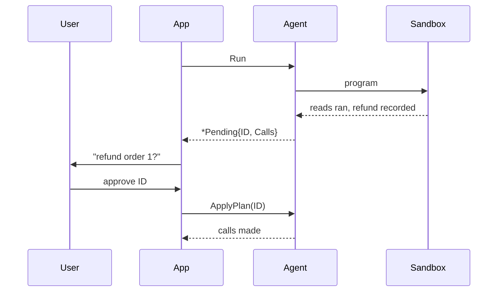

# Approving writes

Some writes should not happen until a person says yes: a refund, a delete, an
email to a customer. Mark them, and the program that calls one runs its reads,
records the write instead of making it, and returns the plan for approval.

```go
gosource.Func("orders.refund", "Refunds a paid order by ID.",
	gosource.Roles("support"), shop.Refund, gosource.NeedsApproval())
```

In protobuf:

```protobuf
rpc Refund(RefundOrderRequest) returns (RefundOrderResponse) {
  option (codemode.description) = "Refunds a paid order by ID.";
  option (codemode.needs_approval) = true;
}
```

A read cannot need approval; declaring both is an error when the source is built.

## The flow

```go
plans := agent.NewMemoryPlans(0) // once, at startup

_, err := agent.Run(ctx, mode, model, request, agent.Options{
	Runner: runner, Plans: plans, PlanOwner: user.ID,
})
var pending *agent.Pending
if errors.As(err, &pending) {
	// show pending.Calls; send pending.ID to the client
}

// later, when the same user approves:
calls, err := agent.ApplyPlan(ctx, mode, plans, user.ID, id)
```



## What is guaranteed

- A write that needs approval never runs without `Apply` or `ApplyPlan`. Called
  outside `agent.Run`, with no recorder, it fails with a permanent error rather
  than running.
- Once a write is held, **every later write in the same program is held too**,
  so the plan keeps the program's order. Writes before it have already run.
- The plan stays on the server. The client sends back only the ID, so it cannot
  change what was approved.
- A plan applies once, only for its `PlanOwner`, and expires (`DefaultPlanTTL`,
  15 minutes, for the memory store).
- `ApplyPlan` takes the caller's *current* runtime: every call passes
  validation, the registry and your handler's checks again, so a user who lost a
  role cannot apply a plan made before.

Without a `PlanStore`, `Pending.ID` is empty and you apply `Pending.Calls` with
`agent.Apply` yourself.

`agent.NewMemoryPlans` keeps plans in one process. With more than one replica,
implement `agent.PlanStore` (`Save`, `Take`) on your database; `Take` must
delete the plan it returns.

## Limits

A held write returns `{}` to the program, so a program that uses a held write's
output — the ID of an order it just created, say — cannot plan the steps after
it accurately. Approve, then ask again.

MCP clients cannot approve yet: `run_program` refuses a program that reaches a
write needing approval and says which writes did not run. Ask the user to make
that change in your application.

`agent.Options.Plan` still holds *every* write, approval or not, for a dry run.
