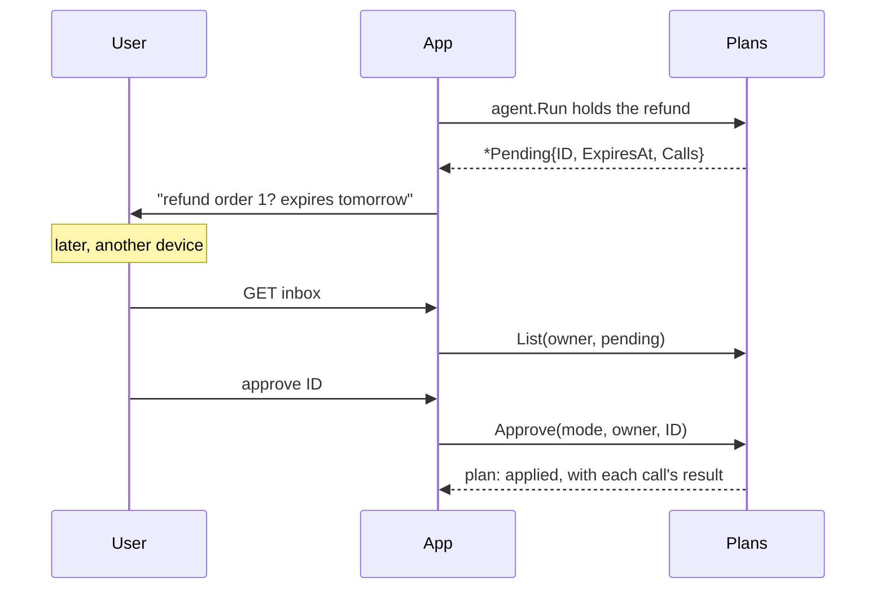
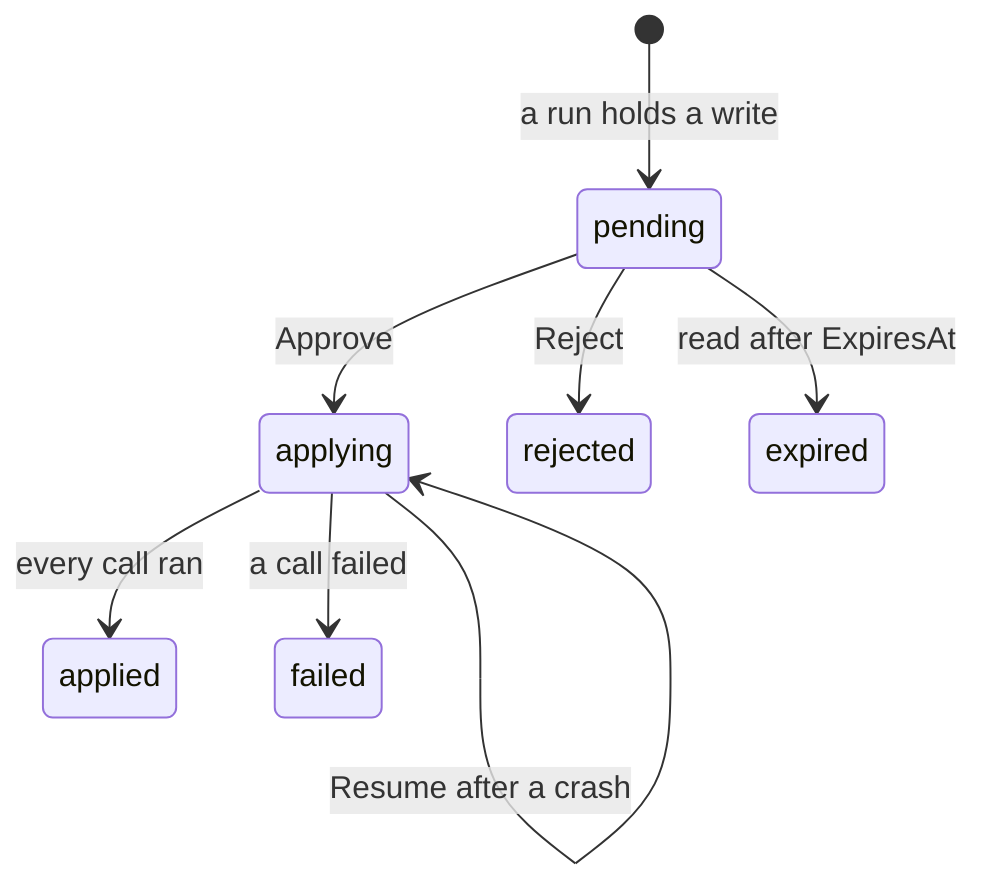

# Approving writes

Some writes should not happen until a person says yes: a refund, a delete, an
email to a customer. Mark them, and the program that calls one runs its reads,
records the write instead of making it, and leaves a **plan** that waits for a
decision — for minutes or for days.

```go
gosource.Func("orders.refund", "Refunds a paid order by ID.",
	gosource.Roles("support"), shop.Refund, gosource.NeedsApproval())
```

In protobuf: `option (codemode.needs_approval) = true;`. A read cannot need
approval; declaring both is an error when the source is built.

## Set up once

```go
db, _ := sql.Open("sqlite3", "app.db")                // or "pgx" for Postgres; your driver
store, _ := sqlplans.Open(ctx, db, sqlplans.SQLite)   // creates the codemode_plans table
plans := agent.NewPlans(store, agent.PlanOptions{
	TTL:     24 * time.Hour,                          // how long a plan waits
	OnEvent: agent.LogEvents(logger),                 // see Observability
})
```

`agent.NewMemoryPlanStore()` works the same for tests and single-process demos;
it forgets everything on restart.

## The flow

```go
_, err := agent.Run(ctx, mode, model, request, agent.Options{
	Runner: runner, Plans: plans, PlanOwner: user.ID,
})
var pending *agent.Pending
if errors.As(err, &pending) {
	// pending.ID, pending.ExpiresAt, pending.Calls: send them to the client
}

inbox, _ := plans.List(ctx, user.ID, agent.PlanPending) // after a reload, tomorrow, anywhere

plan, err := plans.Approve(ctx, mode, user.ID, id)      // runs the calls, once
plan, err := plans.Reject(ctx, user.ID, id, "not now")  // runs nothing
```

`Approve` takes the caller's *current* runtime: every call passes validation,
the registry and your handler's checks again, so a user who lost a role since
the plan was made cannot apply it.



## States



Every move is recorded in `plan.History` with its time, who made it and a note,
so the plan is its own audit trail. Nothing else is allowed:

- **Only a pending plan is decided.** Two clicks, two tabs or two replicas
  approving at once: the store's compare-and-set lets exactly one through, and
  the rest get `ErrPlanDecided`.
- **Expiry** is checked whenever a plan is read — by `Get`, `List`, `Approve` or
  `Reject` — and the plan moves to `expired` with an event. No background job.
- **Applying records each call's result before the next one runs.** If the
  process dies halfway, the plan stays `applying`; `plans.Resume` continues from
  the first call with no result. The call that was in flight may have committed,
  so make those handlers idempotent or check before resuming.
- **A failed call stops the plan.** Its status becomes `failed`, later calls do
  not run, and `plan.Applied` shows which ran and why the last one failed.

## Errors say what happened

| Situation | Error | Message |
| --- | --- | --- |
| Unknown ID, or another owner's | `ErrNoPlan` | `plan 3f2a…: no such plan` |
| Past its time | `ErrPlanExpired` | `plan 3f2a… expired at 2026-11-17T12:00:00Z` |
| Already decided | `ErrPlanDecided` | `plan 3f2a… is already applied (by ada at 2026-11-16T14:02:00Z)` |
| A call failed | wraps the handler's error | `plan 3f2a…: call 2 of 3 (tasks.delete): task is locked` |

`Approve` and `Reject` return the plan as it stands even with an error, so the
client can show the real state instead of a bare failure. Every plan carries
`RunID`, the run that held it, which ties it to that run's events and errors.

## In a web app

[`examples/taskreport`](https://github.com/mukezhz/codemode/tree/main/examples/taskreport)
keeps plans in its own SQLite file. The chat response carries the plan; the
**Approvals** page lists every plan with its expiry and history from
`GET /api/plans`; Approve and Reject post to `/api/plans/{id}/approve` and
`/reject`, which answer 409 for a decided plan and 410 for an expired one.

A delete from the task board is a button the user pressed, so the server runs it
with approval granted:

```go
approved := codemode.WithRecorder(ctx, &codemode.Recorder{Approved: true})
output, err := mode.Execute(approved, "tasks.delete", input)
```

## Limits

- A held write returns `{}` to the program, so steps that use its output — the
  ID of an order it just created — cannot be planned accurately. Approve, then
  ask again.
- A plan is decided by its owner. Approval by another role is not built yet.
- MCP clients cannot approve: `run_program` refuses a program that reaches such
  a write and names what did not run.
- Without `Options.Plans`, `Pending.ID` is empty; keep `Pending.Calls` yourself
  and run them with `agent.Apply`.
- `Options.Plan` still holds *every* write for a dry run, approval or not.
