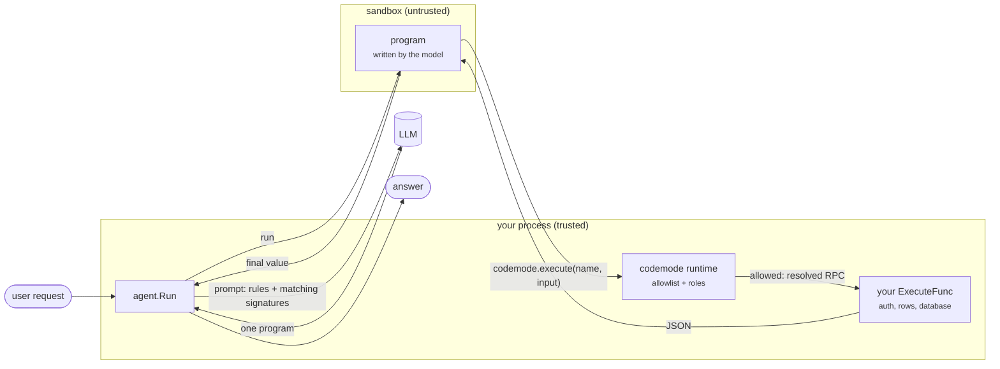
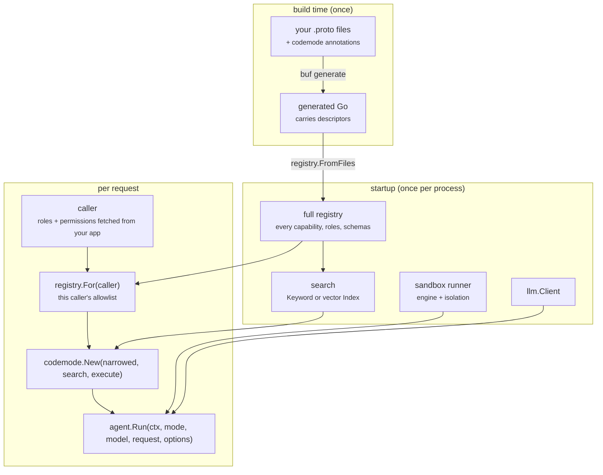
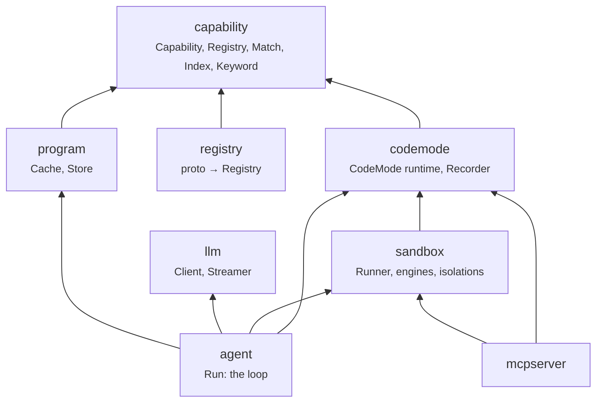
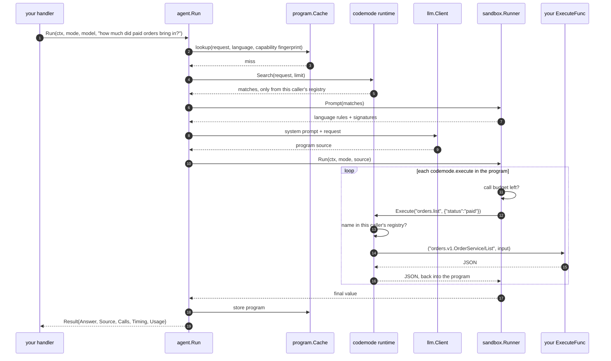
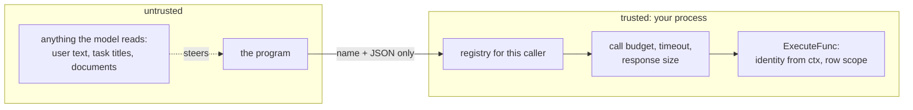
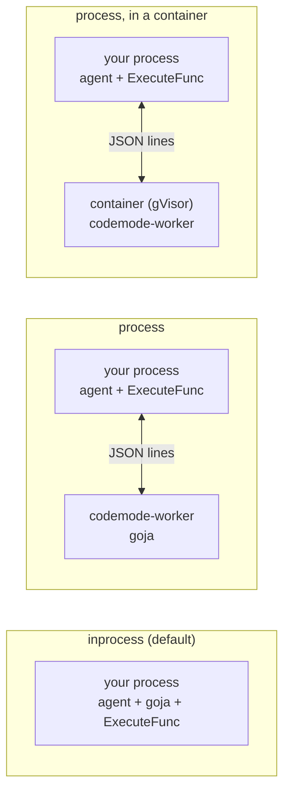
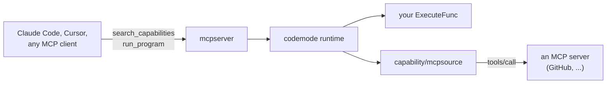

# Architecture

Code mode sits between a language model and your application. The model never
calls your API directly. It writes a short program; the program runs in a
sandbox; every call the program makes comes back to your Go code, which checks
it against an allowlist generated from your protobuf contracts before anything
runs.



Three ideas carry the whole design:

1. **One model turn, many calls.** The program loops and filters at machine
   speed. Intermediate results go back into the program, not into the model.
2. **The model chooses, the host decides.** The model can write anything. Only
   names in this caller's registry resolve, and only your `ExecuteFunc` touches
   data.
3. **Everything swappable is an interface.** Search store, model provider,
   sandbox language, where programs run, program cache: each is a port with
   adapters you pick by import and configuration.

## Two phases: build time and run time



- **Build time** turns contracts into Go. The generated package embeds its own
  descriptors, so nothing else has to be generated or kept in sync.
- **Startup** builds the expensive, shared things once: the full registry, the
  search index, the model client, the sandbox runner.
- **Per request** builds the cheap, caller-specific things: the narrowed
  registry and the runtime bound to it. That is a slice and a map; do it every
  time.

## Packages



Arrows point at what a package imports. Nothing at the bottom knows what sits
above it, and **none of these packages imports a third-party SDK**: importing
`codemode` alone links nothing outside the standard library and protobuf.
`scripts/check-consumer.sh` fails the build if that ever changes.

| Package | Job | You call |
| --- | --- | --- |
| `capability` | The vocabulary: a capability, a registry, a search match. Narrowing (`ForRole`, `Select`, `Require`), merging, keyword and vector search. | `For`, `Keyword`, `Merge` |
| `registry` | Reads protobuf descriptors and the codemode annotations into a `capability.Registry`. | `FromFiles` |
| `codemode` | The runtime the sandbox talks to. Resolves a capability name against the registry, calls `ExecuteFunc` with the RPC path, records calls. | `New` |
| `sandbox` | Runs a program and writes the prompt for its language. Engines and isolations register themselves. | `New`, `NewFromEnv` |
| `llm` | One interface over model providers. | `New`, `NewFromEnv` |
| `program` | Caches generated programs so a repeated request skips the model. | `NewExactCache`, `New` |
| `agent` | The loop: cache → search → prompt → model → sandbox → repair on error. | `Run`, `Answer` |
| `mcpserver` | Serves a runtime to MCP clients as two tools. | `New` |

## Ports and adapters

Each port is an interface in a parent package. Adapters live in child packages
and register themselves from `init`, so **your binary links only what you
blank-import**, and configuration picks among what is linked.

| Port | Adapters | Pick with |
| --- | --- | --- |
| `sandbox` engine | `sandbox/goja` (JavaScript), `sandbox/starlark`, `sandbox/lua` | `SANDBOX_ENGINE` |
| `sandbox` isolation | in-process (built in), `sandbox/subprocess` (`codemode-worker`, optionally in a container) | `SANDBOX_ISOLATION` |
| `llm.Client` | `llm/claude`, `llm/openai` (and any compatible endpoint) | `LLM_PROVIDER`, or whichever key is set |
| `capability.Store` (vector search) | `capability/sqlitestore`, `capability/pgstore` | `CAPABILITY_DB` |
| `program.Cache` | `program.NewExactCache`, `program.New` (semantic) | in code |
| `program.Store` | in memory, `sqlitestore`, `pgstore` | in code |
| capability source | protobuf (`registry`), MCP servers (`capability/mcpsource`) | in code |

```go
import (
	_ "github.com/mukezhz/codemode/llm/claude"         // links the Anthropic SDK
	_ "github.com/mukezhz/codemode/sandbox/goja"       // links goja
	_ "github.com/mukezhz/codemode/sandbox/subprocess" // links nothing new
)
```

Forget an import and `New` says exactly which line to add. See
[What your binary links](/dependencies).

## One request, end to end



- **Step 2** makes a repeated request cost milliseconds: the program, not the
  answer, is cached, and it re-runs against current data.
- **Steps 4 to 7**: the prompt contains only capabilities this caller may call,
  written in the sandbox's own language.
- **The loop** is where the work happens, with no model in it.
- **On error** (a typo, a wrong field), `agent.Run` gives the model the program
  and the error and asks again, up to `Options.Attempts`.

The full walk-through with the actual prompt and program is
[The flow, step by step](/flow).

## Where the boundaries are



| Boundary | What enforces it | Lives in |
| --- | --- | --- |
| Which capabilities exist for this caller | `For(caller)`: the roles and permissions your app holds for them, against `(codemode.roles)` and `(codemode.permissions)` | your protos + your app |
| Whether a name resolves at all | a map lookup in the runtime | `codemode` |
| How many calls, how long, how large | call budget, timeout, response limit | `sandbox` options |
| Which rows a call may touch | the identity on `ctx`, never a field in the input | **your `ExecuteFunc`** |
| What the program can reach besides the bridge | the sandbox: no files, network, env; with `process` isolation, a separate process | `sandbox` |

The program is treated as hostile because anyone who can put text in front of
the model can steer it. Every check that matters runs on the trusted side, so a
program that escapes its interpreter still has nothing to call but the bridge.
See [Permissions](/permissions) and [`SECURITY.md`](https://github.com/mukezhz/codemode/blob/main/SECURITY.md).

## Where programs run



| | Use for | Set |
| --- | --- | --- |
| `inprocess` | development, trusted internal users | nothing |
| `process` | end users of one organisation | `SANDBOX_ISOLATION=process` |
| `process` in a container | many tenants, untrusted input | plus `SANDBOX_WORKER="docker run ..."`, `SANDBOX_WORKER_CONTAINER=true` |

The language, the prompt and the program are identical in all three; only where
the interpreter runs changes. See [Running the worker](/worker).

## Other ways in and out

Code mode is a library first. Two packages connect it to the MCP ecosystem:



- **[`mcpserver`](/mcp)**: your capabilities as two MCP tools. The client's model
  writes the program.
- **[`capability/mcpsource`](/capabilities#capabilities-from-an-mcp-server)**:
  another MCP server's tools as capabilities, so one program can call
  `github.listIssues` next to `orders.list`. Imported tools always require a role.

To see these pieces added to a real application, follow
[Adding it to an existing app](/existing-app), which walks a CRM through it.

## What you write, what you get

| You write | Code mode provides |
| --- | --- |
| protobuf services with a namespace and a description per RPC | the registry, the schemas, the prompt in three languages |
| `(codemode.roles)` on what is privileged | per-caller allowlists, and their absence from the prompt |
| `ExecuteFunc`: RPC path + JSON in, JSON out | the sandbox, the bridge, call budgets, recording, retries |
| which caller this is | search, caching, model calls, repair on error |

`ExecuteFunc` is the one piece nobody can write for you. It is also the only
place that touches your data, which is what keeps the rest swappable.

## Extending it

| To add | Implement | Then |
| --- | --- | --- |
| a sandbox language | `sandbox.Runner` | `sandbox.RegisterEngine` from `init`; add a row to `sandbox/enginetest` |
| a place to run programs | `sandbox.Runner` wrapping an engine | `sandbox.RegisterIsolation` from `init` |
| a model provider | `llm.Client` (and `llm.Streamer`) | register from `init`; add to `llm/providertest` |
| a vector store | `capability.Store` | register from `init` |
| a program cache | `program.Cache` or `program.Store` | pass it in `agent.Options` |
| a capability source | a function returning `capability.Registry` + `ExecuteFunc` | `capability.Merge` it into the registry |

Each adapter declares `var _ Port = (*impl)(nil)` beside its type, so
`git grep 'var _ sandbox.Runner'` lists every implementation.

## Decisions behind this

| Decision | Record |
| --- | --- |
| Adapters register themselves; parents never switch on a vendor | `notes/decisions/0002-pluggable-backends.md` |
| The library takes options; only `env.go` files read the environment | `notes/decisions/0003-explicit-configuration.md` |
| The registry is derived from compiled descriptors | `notes/decisions/0004-registry-from-descriptors.md` |
| Out-of-process sandbox over JSON lines | `notes/decisions/0005-subprocess-runner.md` |
| MCP server: two generic tools, the client writes the program | `notes/decisions/0006-mcp-server-shape.md` |
