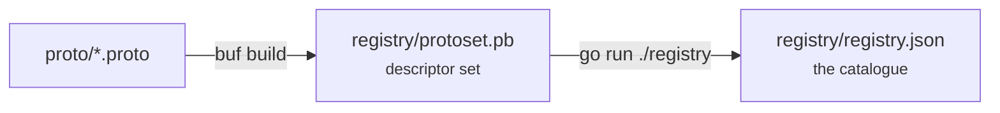
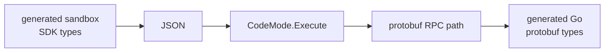

# Capabilities

A capability is one unary protobuf RPC, plus enough metadata for a model to
understand when to call it. The registry is generated from your contracts, so
there is no second place to keep in sync.

## Define one

Capabilities start as unary RPCs in `proto/`:

```proto
import "code_mode.proto";

service StudentService {
  option (code_mode.namespace) = "students";

  rpc InterviewsWithin(InterviewsWithinRequest)
      returns (InterviewsWithinResponse) {
    option (code_mode.description) =
        "Returns students with an interview in the requested period.";
  }
}
```

The generator requires:

- An import of `code_mode.proto`.
- An explicit, lower-camel-case `(code_mode.namespace)` service option.
- A non-empty `(code_mode.description)` option on every RPC.
- Unique generated names. The example becomes `students.interviewsWithin`.
- Unary RPCs. Client- and server-streaming methods are rejected.
- Request and response messages present in the descriptor set.

::: tip Write descriptions for a reader
The description is the single strongest signal a model has for whether to call
something. It ends up verbatim in the prompt. "Returns students with an interview
in the requested period" beats "InterviewsWithin RPC".
:::

## Field types

Field names stay protobuf `snake_case`. Types are rendered in a compact,
script-oriented form, because a model is going to read them:

| Protobuf | Registry type |
| --- | --- |
| `bool` | `boolean` |
| `string` | `string` |
| `bytes` | `Uint8Array` |
| Numeric scalar | `number` |
| Message or enum | Its unqualified type name |
| `repeated T` | `T[]` |
| `map<K, V>` | `Record<K, V>` |

Schemas describe the direct fields of each request and response. Referenced
message types are named, not recursively expanded.

## Generate the registry

Install the pinned Buf version once, then generate from the repository root:

```sh
mise install
make generate
```

`make generate` runs two steps:



Both outputs are generated and ignored by Git. Regenerate after every contract or
option change. The registry is deterministic for a given descriptor ordering:

```json
{
  "capabilities": [{
    "name": "students.interviewsWithin",
    "rpc": "student.v1.StudentService/InterviewsWithin",
    "description": "Returns students with an interview in the requested period.",
    "input": {
      "type": "InterviewsWithinRequest",
      "fields": { "days": "number" }
    },
    "output": {
      "type": "InterviewsWithinResponse",
      "fields": { "students": "Student[]" }
    }
  }]
}
```

Shared JSON types live in `capability/schema.go`; the generator aliases them so
generation and search cannot drift onto separate schemas.

## Wire up the runtime

`codemode.New` takes the registry as its executable allowlist, a search function,
and a trusted executor:

```go
data, err := os.ReadFile("registry/registry.json")
if err != nil {
    return err
}
var registry capability.Registry
if err := json.Unmarshal(data, &registry); err != nil {
    return err
}

mode, err := codemode.New(registry, index.Search, executeRPC)
```

The interface is two methods:

```go
type CodeMode interface {
    Search(ctx context.Context, query string, limit int) ([]capability.Match, error)
    Execute(ctx context.Context, name string, input json.RawMessage) (json.RawMessage, error)
}
```

`Execute` checks that `name` exists in the registry, resolves it to a path such
as `todo.v1.TodoService/Complete`, and passes that path and the JSON to your
`ExecuteFunc`. The caller passes a **name**, never a raw RPC path — that is the
security boundary.

## Implementing ExecuteFunc

Three ways, in increasing order of how well they scale.

**A switch on the path.** What the Todo example does. Fine for a demo, dies at
thirty capabilities.

**A switch onto generated clients.** `buf generate` gives you typed clients;
bridge JSON with `protojson`. Compile-checked, but the switch grows with every
method.

**Dynamic invoke.** gRPC method paths are strings on the wire already, and your
registry holds them. So no switch is needed at all:

```go
func dynamicExecute(conn *grpc.ClientConn, files *protoregistry.Files) codemode.ExecuteFunc {
    return func(ctx context.Context, rpc string, input json.RawMessage) (json.RawMessage, error) {
        service, method, _ := strings.Cut(rpc, "/")

        desc, err := files.FindDescriptorByName(protoreflect.FullName(service))
        if err != nil {
            return nil, err
        }
        md := desc.(protoreflect.ServiceDescriptor).Methods().ByName(protoreflect.Name(method))
        if md == nil {
            return nil, fmt.Errorf("unknown method %q", rpc)
        }

        req := dynamicpb.NewMessage(md.Input())
        res := dynamicpb.NewMessage(md.Output())

        if err := protojson.Unmarshal(input, req); err != nil {
            return nil, err // schema violation, caught before the wire
        }
        if err := conn.Invoke(ctx, "/"+rpc, req, res); err != nil {
            return nil, err
        }
        return protojson.Marshal(res)
    }
}
```

Build `protoregistry.Files` from the same `registry/protoset.pb` the generator
already produces, via `protodesc.NewFiles`. Add a proto method, run
`make generate`, and it is callable — no Go changes.

## Type safety at the boundary

The execution boundary uses JSON on purpose. One `CodeMode` instance executes
many unrelated contracts, and a sandbox in another language has to exchange
language-neutral values.

Making it `CodeMode[Request, Response]` would bind the runtime to one
request/response pair, so it could no longer execute `todos.create`,
`todos.list`, and `todos.complete` together. Go also does not allow an interface
method to introduce its own type parameters.

Type safety belongs on each side of the JSON, not in the middle of it:



The Todo application already decodes strictly into concrete Go structs and
rejects unknown fields. Once Go types are generated from the contracts, a generic
helper can give trusted Go callers typed calls while still delegating to the raw
interface.
