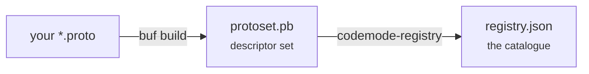
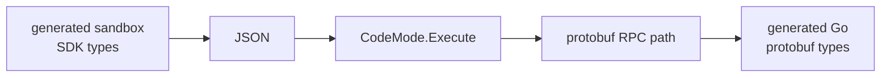

# Capabilities

A capability is one unary protobuf RPC, plus enough metadata for a model to
understand when to call it. The registry is generated from your contracts, so
there is no second place to keep in sync.

## Define one

Capabilities start as unary RPCs in `proto/`:

```proto
import "codemode.proto";

service StudentService {
  option (codemode.namespace) = "students";

  rpc InterviewsWithin(InterviewsWithinRequest)
      returns (InterviewsWithinResponse) {
    option (codemode.description) =
        "Returns students with an interview in the requested period.";
  }
}
```

Two more options are optional. `(codemode.roles)` on a method, and
`(codemode.default_roles)` on a service, name the caller roles allowed to use
it:

```protobuf
service AdminService {
  option (codemode.namespace) = "admin";
  option (codemode.default_roles) = "admin";   // every method inherits this

  rpc Impersonate(ImpersonateRequest) returns (SessionResponse) {
    option (codemode.description) = "Starts a session as another user.";
    option (codemode.roles) = "owner";         // narrower still
  }
}
```

A method's `(codemode.roles)` replaces its service's default rather than adding
to it. No annotation means no restriction. `Registry.ForRole` then narrows a
registry per caller, and `Registry.Unrestricted()` returns what nobody
restricted — worth asserting in a test, since that is where a forgotten
annotation shows up. See [Many services, many users](/scaling-up).

The generator requires:

- An import of `codemode.proto`.
- An explicit, lower-camel-case `(codemode.namespace)` service option.
- A non-empty `(codemode.description)` option on every RPC.
- Unique generated names. The example becomes `students.interviewsWithin`.
- Unary RPCs. Client- and server-streaming methods are rejected.
- Request and response messages present in the descriptor set.

::: tip Write descriptions for a reader
The description is the single strongest signal a model has for whether to call
something. It ends up verbatim in the prompt. "Returns students with an interview
in the requested period" beats "InterviewsWithin RPC".
:::

## Field types

Field names stay protobuf `snake_case`. Types stay in protobuf's own
vocabulary, with one simplification: every numeric scalar collapses to `number`,
because every one of them crosses the bridge as a JSON number.

| Protobuf | Registry type |
| --- | --- |
| `bool` | `bool` |
| `string` | `string` |
| `bytes` | `bytes` |
| Numeric scalar | `number` |
| Message or enum | Its unqualified type name |
| `repeated T` | `repeated T` |
| `map<K, V>` | `map<K, V>` |

Schemas describe the direct fields of each request and response. Every message
they refer to travels alongside, transitively, in `Capability.Types`:

```json
"output": { "type": "GroupCountsResponse", "fields": { "groups": "repeated GroupCount" } },
"types":  { "GroupCount": { "type": "GroupCount",
             "fields": { "name": "string", "open": "number", "total": "number" } } }
```

The prompt renders them once, after the declarations, under "Shapes referred to
above". Without them a model reads `repeated GroupCount` and has to guess what a
`GroupCount` holds — and a wrong guess does not fail. Reading `group.project`
when the field is `group.name` yields `undefined`, so the program runs, the
answer arrives, and it is quietly wrong.

Recursion is bounded, so a message that refers to itself terminates. Map entry
messages are skipped, since `map<K, V>` already says their shape.

### Why the registry is language-neutral

The registry is data, read by three sandbox dialects that disagree about how to
spell a list. Committing it to one syntax would mean showing a model asked for
Lua a type written in TypeScript. So the registry stores the neutral form and
each dialect renders it, in `sandbox/internal/prompt`:

| Registry | JavaScript | Starlark | Lua |
| --- | --- | --- | --- |
| `bool` | `boolean` | `bool` | `boolean` |
| `number` | `number` | `int\|float` | `number` |
| `bytes` | `string (base64)` | `string (base64)` | `string (base64)` |
| `Todo` | `Todo` | `Todo` | `Todo` |
| `repeated Todo` | `Todo[]` | `[Todo]` | `{Todo}` |
| `map<string, Todo>` | `Record<string, Todo>` | `{string: Todo}` | `{[string] = Todo}` |

Bytes are a base64 `string` in all three, including JavaScript. That is not a
simplification for the model's benefit — it is what actually arrives. The bridge
returns decoded protojson, and protojson encodes `bytes` as base64 text. Decode
it in the program if you need the octets, or keep bytes out of capability
schemas and pass a handle instead.

Adding a dialect means adding a `prompt.Types` value beside its `prompt.Dialect`
in a new `sandbox/<engine>` package; nothing else in the pipeline knows a
language exists.

## Generate the registry

Install the pinned Buf version once, then generate from the repository root:

```sh
mise install
make generate
```

`make generate` runs two steps:



Both outputs are generated and ignored by Git. Regenerate after every contract or
option change. The registry is deterministic for a given descriptor ordering:

```json
{
  "capabilities": [{
    "name": "students.interviewsWithin",
    "rpc": "student.v1.StudentService/InterviewsWithin",
    "description": "Returns students with an interview in the requested period.",
    "input": {
      "type": "InterviewsWithinRequest",
      "fields": { "days": "number" }
    },
    "output": {
      "type": "InterviewsWithinResponse",
      "fields": { "students": "repeated Student" }
    }
  }]
}
```

Shared JSON types live in `capability/schema.go`; the generator aliases them so
generation and search cannot drift onto separate schemas.

## Wire up the runtime

`codemode.New` takes the registry as its executable allowlist, a search function,
and a trusted executor:

```go
registry, err := capability.LoadFile("registry.json")
if err != nil {
    return err
}

mode, err := codemode.New(registry, index.Search, executeRPC)
```

The interface is two methods:

```go
type CodeMode interface {
    Search(ctx context.Context, query string, limit int) ([]capability.Match, error)
    Execute(ctx context.Context, name string, input json.RawMessage) (json.RawMessage, error)
}
```

`Execute` checks that `name` exists in the registry, resolves it to a path such
as `todo.v1.TodoService/Complete`, and passes that path and the JSON to your
`ExecuteFunc`. The caller passes a **name**, never a raw RPC path — that is the
security boundary.

## Implementing ExecuteFunc

Three ways, in increasing order of how well they scale.

**A switch on the path.** What the Todo example does. Fine for a demo, dies at
thirty capabilities.

**A switch onto generated clients.** `buf generate` gives you typed clients;
bridge JSON with `protojson`. Compile-checked, but the switch grows with every
method.

**Dynamic invoke.** gRPC method paths are strings on the wire already, and your
registry holds them. So no switch is needed at all:

```go
func dynamicExecute(conn *grpc.ClientConn, files *protoregistry.Files) codemode.ExecuteFunc {
    return func(ctx context.Context, rpc string, input json.RawMessage) (json.RawMessage, error) {
        service, method, _ := strings.Cut(rpc, "/")

        desc, err := files.FindDescriptorByName(protoreflect.FullName(service))
        if err != nil {
            return nil, err
        }
        md := desc.(protoreflect.ServiceDescriptor).Methods().ByName(protoreflect.Name(method))
        if md == nil {
            return nil, fmt.Errorf("unknown method %q", rpc)
        }

        req := dynamicpb.NewMessage(md.Input())
        res := dynamicpb.NewMessage(md.Output())

        if err := protojson.Unmarshal(input, req); err != nil {
            return nil, err // schema violation, caught before the wire
        }
        if err := conn.Invoke(ctx, "/"+rpc, req, res); err != nil {
            return nil, err
        }
        return registry.MarshalJSON(res) // the shape the model was told about
    }
}
```

Build `protoregistry.Files` from the same descriptor set the generator consumes,
via `protodesc.NewFiles`. Add a proto method, regenerate, and it is callable —
no Go changes.

## Type safety at the boundary

The execution boundary uses JSON on purpose. One `CodeMode` instance executes
many unrelated contracts, and a sandbox in another language has to exchange
language-neutral values.

Making it `CodeMode[Request, Response]` would bind the runtime to one
request/response pair, so it could no longer execute `todos.create`,
`todos.list`, and `todos.complete` together. Go also does not allow an interface
method to introduce its own type parameters.

Type safety belongs on each side of the JSON, not in the middle of it:



The Todo application already decodes strictly into concrete Go structs and
rejects unknown fields. Once Go types are generated from the contracts, a generic
helper can give trusted Go callers typed calls while still delegating to the raw
interface.

## Capabilities from an MCP server

`capability/mcpsource` imports an MCP server's tools as capabilities, so one
program can call `github.listIssues` next to `tasks.list`.

```go
session, _ := mcp.NewClient(&mcp.Implementation{Name: "host"}, nil).Connect(ctx, transport, nil)
github, _ := mcpsource.Import(ctx, session, "github", "engineer")

registry, _ := capability.Merge(own, github.Registry) // fails on a duplicate name
execute := func(ctx context.Context, rpc string, input json.RawMessage) (json.RawMessage, error) {
    if strings.HasPrefix(rpc, mcpsource.RPCPrefix("github")) {
        return github.Execute(ctx, rpc, input)
    }
    return app.Execute(ctx, rpc, input)
}
mode, _ := codemode.New(registry.ForRoles(roles...), search, execute) // roles fetched from your app
```

What it does not trust:

- **Roles.** MCP has no role annotations, so `Import` requires a role and every
  imported tool requires it. An empty role is an error, never "unrestricted".
- **Hints.** A server's `readOnlyHint` is a claim by code you do not control.
  Every imported tool is a write, so plan mode and retries treat it carefully.
- **Vague schemas.** A tool whose JSON Schema cannot be named precisely (`oneOf`,
  untyped properties) is left out and listed in `Skipped`, rather than loosened to
  "anything", which would tell the model a call is valid when it is not.

A tool without an output schema returns `{ text }`, its text content joined.
