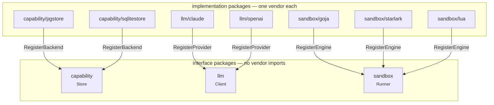

# What your binary links

Every swappable piece in this library is an interface in one package and an
implementation in another. You blank-import the implementations you want, they
register themselves, and your binary links nothing else.

```go
import (
	"github.com/mukezhz/codemode/agent"
	"github.com/mukezhz/codemode/codemode"

	_ "github.com/mukezhz/codemode/capability/pgstore"  // pgvector search
	_ "github.com/mukezhz/codemode/llm/claude"          // Anthropic
	_ "github.com/mukezhz/codemode/sandbox/goja"        // JavaScript
)
```

Those three lines are the whole configuration surface. The environment still
picks between what is registered — `SANDBOX_ENGINE`, `LLM_PROVIDER`,
`CAPABILITY_DB` — but it can only pick something you compiled in.

## Why it works this way

`capability` holds `Registry`, the type everything else is built on. Before the
split, it also held both database backends, so importing anything at all linked
the SQLite driver — which is cgo:

```
$ CGO_ENABLED=0 go build ./...
capability/sqlite.go:49:21: sqliteConn.LoadExtension undefined
```

A library that cannot produce a static binary cannot go in a distroless or
scratch image, which is where most Go services live. The same argument applies
in miniature to the interpreters and the model SDKs: linking goja, Starlark,
Lua, the Anthropic SDK, and the OpenAI SDK to run one of each is waste with no
upside.

## What each import costs

| Blank import | Links | cgo |
| --- | --- | --- |
| *(nothing — just `codemode`)* | nothing third-party | no |
| `capability/pgstore` | `jackc/pgx` | no |
| `capability/sqlitestore` | `mattn/go-sqlite3` | **yes** |
| `llm/claude` | `anthropics/anthropic-sdk-go` | no |
| `llm/openai` | `openai/openai-go` | no |
| `sandbox/goja` | `dop251/goja` | no |
| `sandbox/starlark` | `go.starlark.net` | no |
| `sandbox/lua` | `yuin/gopher-lua` | no |

`sqlitestore` is the only entry that forces cgo. If you need static linking and
semantic search, use `pgstore`.

::: tip Embeddings always come from `llm/openai`
Anthropic publishes no embeddings API, so `openai.NewEmbedder()` is the only
embedder — including when Claude writes the programs. Point
`EMBEDDING_BASE_URL` at any compatible endpoint to embed locally.
:::

## The three seams



Registration is one-way. An implementation imports its interface package; the
interface package never imports back. That is what keeps `capability`,
`llm`, and `sandbox` free of vendor code.

| Interface | Implementations |
|---|---|
| `capability.Store` | `capability/sqlitestore`, `capability/pgstore` |
| `program.Cache` | `program.New` (semantic), `program.NewExactCache` |
| `program.Store` | `program.NewMemoryStore`, `capability/sqlitestore`, `capability/pgstore` |
| `llm.Client`, `llm.Streamer` | `llm/claude`, `llm/openai` |
| `sandbox.Runner` | `sandbox/goja`, `sandbox/starlark`, `sandbox/lua` |

Each implementation asserts its interface at compile time with a line such as
`var _ sandbox.Runner = (*luaRunner)(nil)`, so
`git grep 'var _ sandbox.Runner'` lists every engine.

## When you forget an import

The failure is a runtime error at construction, not a compile error — the cost
of choosing a backend from the environment. So the error names the fix:

```
sandbox engine "lua" is not registered:
  add `_ "github.com/mukezhz/codemode/sandbox/lua"` to your imports
```

A genuinely unknown name reads differently, and does not invent an import path:

```
sandbox engine "wasm" is unknown: registered engines are goja, starlark
```

`sandbox.RegisteredEngines()`, `llm.RegisteredProviders()`, and
`capability.RegisteredBackends()` return what is compiled in, which is worth
logging at startup.

## Provider detection

With `LLM_PROVIDER` unset, the library picks whichever provider's own variables
are set. Order is by an explicit `Priority` on each provider, not by import
order — so adding an import cannot silently change which model an existing
deployment uses. Claude is priority 1, OpenAI 2.

`LLM_BASE_URL` alone selects OpenAI, because most self-hosted and third-party
endpoints speak that protocol.

## Adding your own

Nothing about the three shipped sets is privileged. Implement the interface,
register it, blank-import it:

```go
package wasmengine

import "github.com/mukezhz/codemode/sandbox"

func init() {
	sandbox.RegisterEngine(sandbox.Engine{Name: "wasm", New: New})
}

func New(options sandbox.Options) (sandbox.Runner, error) { /* ... */ }
```

A `Runner` written this way is also how you move the sandbox out of process —
see [the isolation ladder](/sandbox#the-isolation-ladder). For a `Store`,
`capability.ScanMatches`, `EncodeSchemas`, and `DecodeSchemas` are exported so a
third-party backend stores and reads rows the same way the shipped ones do.

## Verifying it

`scripts/check-consumer.sh` builds a throwaway module against the working tree
and fails if importing `codemode` alone pulls in anything third-party, or if the
core packages stop building without cgo. It runs in `make test` and in CI, so
the property above is enforced rather than asserted.
