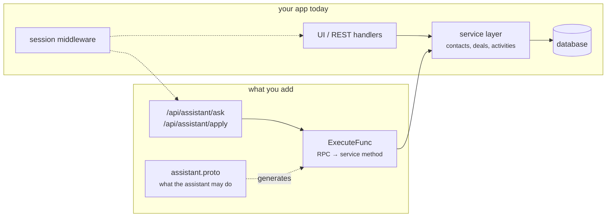
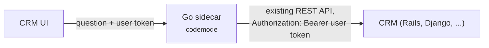

# Adding it to an existing app

You already have an application: a database, a service layer, sessions, roles,
maybe a REST or gRPC API, and users who keep asking for one more report. This
page adds a natural-language assistant to it **without changing the code you
have**: codemode sits beside your service layer and calls it the same way your
API handlers do.

The running example is a CRM. Everything shown here was built and run against a
real model: the transcripts below are real output, including two mistakes that
taught us something.



Your service layer, database, sessions and existing routes stay exactly as they
are. You add one `.proto` file, one adapter package, and two routes.

## Pick your shape

| Your app | Codemode's `ExecuteFunc` calls | Read |
| --- | --- | --- |
| Go, with a service layer | your service methods, in process | [the CRM walkthrough](#the-crm-walkthrough) below |
| Go, with gRPC services | your gRPC services, through one generic dispatcher; annotate the protos you already have | [Strategy B](/using-it#strategy-b-generic-grpc-dispatch) |
| Not Go (Rails, Django, Node, PHP, …) | your existing REST API, from a small Go sidecar, as the signed-in user | [A CRM not written in Go](#a-crm-not-written-in-go) |
| Already has an MCP server | that server's tools, via `capability/mcpsource` | [Capabilities from an MCP server](/capabilities#capabilities-from-an-mcp-server) |
| You want Claude Code or Cursor to use your app | your runtime, served with `mcpserver` | [Serving MCP clients](/mcp) |

In every shape the same three rules hold: the program only sees the capabilities
you describe, every call goes through code you wrote, and that code knows who
the user is from the session, never from the program.

## The CRM walkthrough

The CRM before codemode:

```
crm/
├── internal/auth/     sessions: org (the tenant), user, roles. Middleware puts a Session on the context.
├── internal/crm/      the service layer: SearchContacts, ListDeals, MoveDeal, LogActivity, ...
│                      every method takes a Scope{Org, Owner}; an empty Org reaches nothing.
└── main.go            REST routes for the UI
```

Its users are reps (who see their own book) and managers (who see the whole org),
across many customer organisations. After this walkthrough:

```
crm/
├── proto/crm/v1/assistant.proto    new: what the assistant may do
├── gen/                            new: generated
├── internal/assistant/             new: the only package that imports codemode
│   ├── assistant.go                built once; Ask and Apply per request
│   └── execute.go                  RPC → existing service method
├── internal/auth/, internal/crm/   unchanged
└── main.go                         two new routes
```

### Step 1: decide what the assistant may do

List the questions users actually ask, then the service methods that answer them.
Start with **reads**: they are safe to retry, and they are most of the value.

| Users ask | Existing method | Capability | Who |
| --- | --- | --- | --- |
| "find the contact at Parc" | `SearchContacts` | `contacts.search` | everyone |
| "my deals stuck in negotiation" | `ListDeals` | `deals.list` | everyone, scoped |
| "when did we last talk to them?" | `Activities` | `deals.activities` | everyone, scoped |
| "pipeline by owner" | `ListDeals` (whole org) | `reports.pipeline` | managers |
| "mark it won and log a note" | `MoveDeal`, `LogActivity` | `deals.move`, `deals.logActivity` | everyone, scoped, **confirmed first** |

Leave out anything you would not let a junior employee do on the user's behalf
without asking: bulk deletes, exports, permission changes. A capability that does
not exist cannot be talked into.

### Step 2: write the contract

The contract is not a new public API. It is a description, for the model, of
operations your service layer already has. Keep it in its own file.

`proto/crm/v1/assistant.proto`:

```protobuf
syntax = "proto3";

package crm.v1;

import "codemode.proto";

option go_package = "example.com/crm/gen/crm/v1;crmv1";

// What the assistant may do, described for the model. These RPCs are not a new
// API: each one maps onto a method the CRM's service layer already has.

service ContactService {
  option (codemode.namespace) = "contacts";

  rpc Search(SearchContactsRequest) returns (ContactList) {
    option idempotency_level = NO_SIDE_EFFECTS;
    option (codemode.description) = "Finds contacts whose name or company contains the text. Reps see their own contacts, managers the whole organisation.";
  }
}

service DealService {
  option (codemode.namespace) = "deals";

  rpc List(ListDealsRequest) returns (DealList) {
    option idempotency_level = NO_SIDE_EFFECTS;
    option (codemode.description) = "Lists deals, optionally only one stage: lead, qualified, proposal, negotiation, won or lost. Value is in USD; close_date is YYYY-MM-DD.";
  }

  rpc Activities(DealActivitiesRequest) returns (ActivityList) {
    option idempotency_level = NO_SIDE_EFFECTS;
    option (codemode.description) = "Lists a deal's activities, newest first. at is an RFC 3339 timestamp.";
  }

  rpc Move(MoveDealRequest) returns (Deal) {
    option (codemode.description) = "Moves a deal to another stage.";
  }

  rpc LogActivity(LogActivityRequest) returns (Activity) {
    option (codemode.description) = "Records a call, email, meeting or note against a deal.";
  }
}

service ReportService {
  option (codemode.namespace) = "reports";
  option (codemode.default_roles) = "manager admin";

  rpc Pipeline(PipelineRequest) returns (PipelineReport) {
    option idempotency_level = NO_SIDE_EFFECTS;
    option (codemode.description) = "Open pipeline for the whole organisation, already excluding won and lost deals: deal count and total USD value per stage and per owner.";
  }
}

message Contact {
  int64 id = 1;
  string owner = 2;
  string name = 3;
  string company = 4;
  string email = 5;
}

message Deal {
  int64 id = 1;
  string owner = 2;
  int64 contact_id = 3;
  string title = 4;
  string stage = 5;
  double value = 6;
  string close_date = 7;
}

message Activity {
  int64 id = 1;
  int64 deal_id = 2;
  string kind = 3;
  string note = 4;
  string at = 5;
}

message SearchContactsRequest { string text = 1; }
message ContactList { repeated Contact contacts = 1; }
message ListDealsRequest { string stage = 1; }
message DealList { repeated Deal deals = 1; }
message DealActivitiesRequest { int64 deal_id = 1; }
message ActivityList { repeated Activity activities = 1; }
message MoveDealRequest {
  int64 deal_id = 1;
  string stage = 2;
}
message LogActivityRequest {
  int64 deal_id = 1;
  string kind = 2;
  string note = 3;
}
message PipelineRequest {}
message StageTotal {
  string stage = 1;
  int64 deals = 2;
  double value = 3;
}
message OwnerTotal {
  string owner = 1;
  int64 deals = 2;
  double value = 3;
}
message PipelineReport {
  repeated StageTotal by_stage = 1;
  repeated OwnerTotal by_owner = 2;
}
```

Generate it the way the [Quickstart](/quickstart#_4-generate-go) does, with
`codemode.proto` excluded from generation and from lint:

```yaml
# buf.yaml
version: v2
modules:
  - path: proto
lint:
  use:
    - STANDARD
  except:
    - RPC_REQUEST_STANDARD_NAME
    - RPC_RESPONSE_STANDARD_NAME
    - RPC_REQUEST_RESPONSE_UNIQUE
  ignore:
    - proto/codemode.proto
```

```yaml
# buf.gen.yaml
version: v2
inputs:
  - directory: proto
    exclude_paths:
      - proto/codemode.proto
plugins:
  - remote: buf.build/protocolbuffers/go:v1.36.11
    out: gen
    opt: paths=source_relative
```

::: tip Write the contract for the reader, not for reuse
Our first version shared one `StageTotal { string key }` message between
`by_stage` and `by_owner`. A manager asked for the pipeline by owner and was told
there was none: the model read `key` as a stage and filtered every owner out.
Separate `StageTotal { stage }` and `OwnerTotal { owner }` messages, and
"already excluding won and lost" in the description, fixed it. Field names and
descriptions are the model's only documentation.
:::

### Step 3: the adapter

`ExecuteFunc` receives an RPC path the runtime already checked against this
user's registry, plus the JSON the program sent. It turns that into a call on
your service layer, scoped by the session your middleware already set.

`internal/assistant/execute.go`:

```go
package assistant

import (
	"context"
	"encoding/json"
	"errors"
	"fmt"

	"google.golang.org/protobuf/encoding/protojson"
	"google.golang.org/protobuf/proto"

	"github.com/mukezhz/codemode/codemode"
	"github.com/mukezhz/codemode/registry"

	crmv1 "example.com/crm/gen/crm/v1"
	"example.com/crm/internal/auth"
	"example.com/crm/internal/crm"
)

// execute is the bridge from a program's call to the CRM's existing service
// layer. It is the only code that touches data, and it scopes every call with
// the session the CRM's own middleware put on the context.
func (assistant *Assistant) execute(ctx context.Context, rpc string, input json.RawMessage) (json.RawMessage, error) {
	session, ok := auth.From(ctx)
	if !ok {
		return nil, errors.New("no session on the context") // a wiring bug: never default to "everyone"
	}
	scope := crm.Scope{Org: session.Org, Owner: session.UserID}
	if session.Has("manager") || session.Has("admin") {
		scope.Owner = "" // the whole org, still only this org
	}
	service := assistant.crm

	switch rpc {
	case "crm.v1.ContactService/Search":
		request := &crmv1.SearchContactsRequest{}
		if err := protojson.Unmarshal(input, request); err != nil {
			return nil, err
		}
		response := &crmv1.ContactList{}
		for _, contact := range service.SearchContacts(scope, request.GetText()) {
			response.Contacts = append(response.Contacts, &crmv1.Contact{Id: contact.ID, Owner: contact.Owner,
				Name: contact.Name, Company: contact.Company, Email: contact.Email})
		}
		return registry.MarshalJSON(response)

	case "crm.v1.DealService/List":
		request := &crmv1.ListDealsRequest{}
		if err := protojson.Unmarshal(input, request); err != nil {
			return nil, err
		}
		response := &crmv1.DealList{}
		for _, deal := range service.ListDeals(scope, request.GetStage()) {
			response.Deals = append(response.Deals, dealOut(deal))
		}
		return registry.MarshalJSON(response)

	// ... Activities, LogActivity and Pipeline follow the same pattern ...

	case "crm.v1.DealService/Move":
		request := &crmv1.MoveDealRequest{}
		if err := protojson.Unmarshal(input, request); err != nil {
			return nil, err
		}
		deal, err := service.MoveDeal(scope, request.GetDealId(), request.GetStage())
		return reply(dealOut(deal), err)

	}
	return nil, fmt.Errorf("RPC %q is not implemented", rpc)
}

// reply turns "not found" into an error no rewrite of the program can fix, so
// agent.Run stops instead of retrying, and another org's ID looks like no ID.
func reply(message proto.Message, err error) (json.RawMessage, error) {
	if errors.Is(err, crm.ErrNotFound) {
		return nil, codemode.Permanent(err)
	}
	if err != nil {
		return nil, err
	}
	return registry.MarshalJSON(message)
}

func dealOut(deal crm.Deal) *crmv1.Deal {
	return &crmv1.Deal{Id: deal.ID, Owner: deal.Owner, ContactId: deal.ContactID, Title: deal.Title,
		Stage: deal.Stage, Value: deal.Value, CloseDate: deal.CloseDate}
}
```

Three details that matter:

- **The scope comes from the session**, not from the input. There is no `org` or
  `owner` field in any request message, so a program cannot ask for someone
  else's data.
- **Responses go through `registry.MarshalJSON`**, so the program receives
  exactly the field names and types the model was told about.
- **"Not found" is `codemode.Permanent`**: the agent stops instead of rewriting
  the program, and another org's deal ID looks the same as no deal at all.

### Step 4: the assistant

Built once at startup, used per request. It narrows the registry to the user's
roles and tells the model whose data it is looking at.

`internal/assistant/assistant.go`:

```go
// Package assistant adds a natural-language assistant to the CRM. It is the only
// package that imports codemode; the rest of the CRM is unchanged.
package assistant

import (
	"context"
	"slices"
	"strings"

	"github.com/mukezhz/codemode/agent"
	"github.com/mukezhz/codemode/capability"
	"github.com/mukezhz/codemode/codemode"
	"github.com/mukezhz/codemode/llm"
	"github.com/mukezhz/codemode/program"
	"github.com/mukezhz/codemode/registry"
	"github.com/mukezhz/codemode/sandbox"

	_ "github.com/mukezhz/codemode/llm/claude"
	_ "github.com/mukezhz/codemode/llm/openai"
	_ "github.com/mukezhz/codemode/sandbox/goja"
	_ "github.com/mukezhz/codemode/sandbox/subprocess"

	crmv1 "example.com/crm/gen/crm/v1"
	"example.com/crm/internal/auth"
	"example.com/crm/internal/crm"
)

// Assistant holds what is built once at startup and shared by every request.
type Assistant struct {
	crm    *crm.Service
	full   capability.Registry
	model  llm.Client
	runner sandbox.Runner
	cache  program.Cache
}

func New(service *crm.Service) (*Assistant, error) {
	full, err := registry.FromFiles(crmv1.File_crm_v1_assistant_proto)
	if err != nil {
		return nil, err
	}
	model, err := llm.NewFromEnv()
	if err != nil {
		return nil, err
	}
	runner, err := sandbox.NewFromEnv(sandbox.Options{MaxCalls: 40}) // SANDBOX_ISOLATION=process in production
	if err != nil {
		return nil, err
	}
	return &Assistant{crm: service, full: full, model: model, runner: runner, cache: program.NewExactCache()}, nil
}

func (assistant *Assistant) Close() error { return assistant.runner.Close() }

// Ask answers one question for the signed-in user. With plan set, reads run but
// writes are returned in Result.Planned for the user to confirm.
func (assistant *Assistant) Ask(ctx context.Context, question string, plan bool) (agent.Result, error) {
	session, _ := auth.From(ctx)
	mode, err := assistant.modeFor(session)
	if err != nil {
		return agent.Result{}, err
	}
	return agent.Run(ctx, mode, assistant.model, question, agent.Options{
		Runner:       assistant.runner,
		Cache:        assistant.cache,
		CacheCaller:  strings.Join(slices.Sorted(slices.Values(session.Roles)), ","),
		Plan:         plan,
		Instructions: instructions(session),
	})
}

// Apply runs writes the user confirmed, through the same registry and scope.
func (assistant *Assistant) Apply(ctx context.Context, planned []codemode.Call) ([]codemode.Call, error) {
	session, _ := auth.From(ctx)
	mode, err := assistant.modeFor(session)
	if err != nil {
		return nil, err
	}
	return agent.Apply(ctx, mode, planned)
}

// modeFor narrows the registry to what this user's roles allow. reports.* need manager or admin.
func (assistant *Assistant) modeFor(session auth.Session) (codemode.CodeMode, error) {
	allowed := assistant.full.Select(func(item capability.Capability) bool {
		for _, role := range append([]string{"rep"}, session.Roles...) {
			if item.AllowsRole(role) {
				return true
			}
		}
		return false
	})
	return codemode.New(allowed, capability.Keyword(allowed), assistant.execute)
}

// instructions tells the model whose data the capabilities return. Without it, a
// rep asking about "the whole org" gets their own deals labelled as the org's.
func instructions(session auth.Session) string {
	reach := "only " + session.UserID + "'s own contacts, deals and activities"
	if session.Has("manager") || session.Has("admin") {
		reach = "every contact, deal and activity in the organisation"
	}
	return "You work inside a CRM for " + session.UserID + ". Today is " + today() + ". " +
		"The capabilities return " + reach + ". If a request needs data outside that, " +
		"say plainly that it is outside what you can see; never present partial data as complete."
}
```

::: tip Tell the model what the user can see
Before `instructions` existed, a rep asked for "the pipeline by owner for the
whole org" and got their own two deals presented as the org's pipeline. Every
layer held (they only saw their own rows), and the answer was still wrong. One
sentence naming the caller's reach fixed it:

> Note: I can only see ada's own deals, not the whole organisation's, so this is
> not an org-wide pipeline.
:::

### Step 5: the routes

`main.go`: the existing routes stay; two are added behind the same session middleware.

```go
package main

import (
	"encoding/json"
	"log"
	"net/http"
	"time"

	"github.com/mukezhz/codemode/agent"
	"github.com/mukezhz/codemode/codemode"

	"example.com/crm/internal/assistant"
	"example.com/crm/internal/auth"
	"example.com/crm/internal/crm"
)

func main() {
	service := crm.Seeded(time.Now())

	mux := http.NewServeMux()
	// ... the CRM's existing routes stay exactly as they were ...
	mux.HandleFunc("GET /api/deals", func(writer http.ResponseWriter, request *http.Request) {
		session, _ := auth.From(request.Context())
		json.NewEncoder(writer).Encode(service.ListDeals(crm.Scope{Org: session.Org, Owner: session.UserID}, ""))
	})

	// New: the assistant, behind the same session middleware.
	helper, err := assistant.New(service)
	if err != nil {
		log.Fatal(err)
	}
	defer helper.Close()
	mux.HandleFunc("POST /api/assistant/ask", ask(helper))
	mux.HandleFunc("POST /api/assistant/apply", apply(helper))

	log.Fatal(http.ListenAndServe("127.0.0.1:8090", auth.Middleware(mux)))
}

func ask(helper *assistant.Assistant) http.HandlerFunc {
	return func(writer http.ResponseWriter, request *http.Request) {
		var body struct {
			Question string `json:"question"`
		}
		if err := json.NewDecoder(http.MaxBytesReader(writer, request.Body, 1<<14)).Decode(&body); err != nil {
			http.Error(writer, err.Error(), http.StatusBadRequest)
			return
		}
		// Plan: reads run now, writes wait for the user to confirm them.
		result, err := helper.Ask(request.Context(), body.Question, true)
		if err != nil {
			http.Error(writer, err.Error(), http.StatusBadGateway)
			return
		}
		json.NewEncoder(writer).Encode(map[string]any{
			"answer":  agent.Answer(result.Answer),
			"program": result.Source,
			"planned": result.Planned, // empty unless the question asked for changes
		})
	}
}

func apply(helper *assistant.Assistant) http.HandlerFunc {
	return func(writer http.ResponseWriter, request *http.Request) {
		var body struct {
			Planned []codemode.Call `json:"planned"`
		}
		if err := json.NewDecoder(http.MaxBytesReader(writer, request.Body, 1<<16)).Decode(&body); err != nil {
			http.Error(writer, err.Error(), http.StatusBadRequest)
			return
		}
		// Each call goes through this user's registry and scope again, so an
		// edited plan cannot do more than the user could.
		calls, err := helper.Apply(request.Context(), body.Planned)
		if err != nil {
			http.Error(writer, err.Error(), http.StatusUnprocessableEntity)
			return
		}
		json.NewEncoder(writer).Encode(map[string]any{"applied": calls})
	}
}
```

### Step 6: writes, confirmed by the user

The ask route always runs with `Plan: true`. Reads execute; writes are recorded
and returned instead of run:

```json
{
  "answer": "...",
  "planned": [
    {"name": "deals.move",        "input": {"deal_id": 2, "stage": "won"}},
    {"name": "deals.logActivity", "input": {"deal_id": 2, "kind": "note", "note": "Contract signed."}}
  ]
}
```

Show `planned` as a confirmation ("Move *Parc expansion* to **won**, log a
note?"). When the user confirms, send it to `/api/assistant/apply`.

- **When `planned` is not empty, show the plan, not the answer.** A planned write
  returns `{}` to the program, so the preview answer can say "moved deal
  undefined". The plan is the truth; the answer is a guess about it.
- **An edited plan cannot do more than the user can.** `Apply` sends every call
  through this user's registry and `execute` again. We replayed ada's plan as a
  user from another org: `execute deals.move: not found (permanent)`, and nothing
  changed.

### Step 7: roll it out

| Stage | Set | Why |
| --- | --- | --- |
| Development | nothing | programs run in your process; breakpoints in `execute` work |
| Staging | `SANDBOX_ISOLATION=process`, `SANDBOX_WORKER=...` | the production sandbox, with real data shapes |
| Production, one company | the same | a runaway program kills its worker, not the CRM |
| Production, many customer orgs | plus a container worker | see [Running the worker](/worker#step-5-a-container-per-run) |

Then add what any feature that acts for users needs: a per-user rate limit and
an audit log through `agent.Options.OnCall` ([Roles and tenants](/tenants#sandbox-fairness-and-audit)),
and start with reads only if writes need more review.

### What it did

Real answers from this CRM, `SANDBOX_ISOLATION=process`, an OpenAI-compatible model:

| User | Asked | Answer |
| --- | --- | --- |
| ada (rep, acme) | which of my deals in negotiation have had no activity in the last two weeks? | Parc expansion ($120,000), last activity three weeks ago |
| ada (rep, acme) | show the pipeline by owner for the whole org | says it can only see ada's own deals, then shows them |
| linus (manager, acme) | show the open pipeline by owner | ada: 2 deals, $168,000 · linus: 1 deal, $90,000 · total $258,000 |
| hank (rep, globex) | what stage is the Parc expansion deal in? | no deal matching "Parc" found (it belongs to acme) |
| ada (rep, acme) | move deal 2 to won and log a note that the contract was signed | two planned writes; applied after confirmation |

## A CRM not written in Go

If the CRM is Rails, Django, Node or PHP, run codemode as a small Go service next
to it. Its `ExecuteFunc` calls the CRM's **existing REST API with the signed-in
user's own token**, so the assistant can never do more than the user could in
the UI, and the CRM keeps enforcing its own permissions.



The contract is the same `assistant.proto`. The adapter maps each RPC to an
endpoint and normalises the response to the contract:

```go
// Package sidecar is the shape for a CRM not written in Go: codemode runs in a
// small Go service, and ExecuteFunc calls the CRM's existing REST API as the user.
package sidecar

import (
	"bytes"
	"context"
	"encoding/json"
	"fmt"
	"io"
	"net/http"
	"net/url"

	"google.golang.org/protobuf/encoding/protojson"
	"google.golang.org/protobuf/proto"

	"github.com/mukezhz/codemode/codemode"
	"github.com/mukezhz/codemode/registry"

	crmv1 "example.com/crm/gen/crm/v1"
)

type tokenKey struct{}

// WithToken carries the caller's own CRM token; the sidecar never has more access than the user.
func WithToken(ctx context.Context, token string) context.Context {
	return context.WithValue(ctx, tokenKey{}, token)
}

type route struct {
	method   string
	path     string
	response func() proto.Message
}

// One line per capability: which existing endpoint serves it.
var routes = map[string]route{
	"crm.v1.ContactService/Search": {"GET", "/api/contacts", func() proto.Message { return &crmv1.ContactList{} }},
	"crm.v1.DealService/List":      {"GET", "/api/deals", func() proto.Message { return &crmv1.DealList{} }},
	"crm.v1.DealService/Move":      {"POST", "/api/deals/move", func() proto.Message { return &crmv1.Deal{} }},
}

func Execute(base string, client *http.Client) codemode.ExecuteFunc {
	return func(ctx context.Context, rpc string, input json.RawMessage) (json.RawMessage, error) {
		endpoint, ok := routes[rpc]
		if !ok {
			return nil, fmt.Errorf("RPC %q is not implemented", rpc)
		}
		token, _ := ctx.Value(tokenKey{}).(string)
		if token == "" {
			return nil, fmt.Errorf("no user token on the context")
		}

		target := base + endpoint.path
		var body io.Reader
		if endpoint.method == http.MethodGet {
			var query map[string]any
			if err := json.Unmarshal(input, &query); err != nil {
				return nil, err
			}
			values := url.Values{}
			for key, value := range query {
				values.Set(key, fmt.Sprint(value))
			}
			target += "?" + values.Encode()
		} else {
			body = bytes.NewReader(input)
		}

		request, err := http.NewRequestWithContext(ctx, endpoint.method, target, body)
		if err != nil {
			return nil, err
		}
		request.Header.Set("Authorization", "Bearer "+token)
		request.Header.Set("Content-Type", "application/json")
		response, err := client.Do(request)
		if err != nil {
			return nil, err
		}
		defer response.Body.Close()
		payload, err := io.ReadAll(io.LimitReader(response.Body, 1<<20))
		if err != nil {
			return nil, err
		}
		if response.StatusCode == http.StatusNotFound || response.StatusCode == http.StatusForbidden {
			return nil, codemode.Permanent(fmt.Errorf("not found"))
		}
		if response.StatusCode >= 300 {
			return nil, fmt.Errorf("%s: %s", response.Status, bytes.TrimSpace(payload))
		}

		// Normalise the REST response to the contract the model was given:
		// unknown fields dropped, names, types and empty lists as declared.
		message := endpoint.response()
		if err := (protojson.UnmarshalOptions{DiscardUnknown: true}).Unmarshal(payload, message); err != nil {
			return nil, fmt.Errorf("the CRM's response does not match %s: %w", rpc, err)
		}
		return registry.MarshalJSON(message)
	}
}
```

- **One line per capability** in `routes`. Adding a capability is a proto change
  and a line.
- **The token is the user's**, put on the context by the sidecar's own handler.
  The sidecar holds no service account.
- **Responses are normalised**: decoding into the generated message drops fields
  the contract does not declare (an `internal_flag` the API happens to return
  never reaches the program), and `registry.MarshalJSON` emits the declared shape.
- `403` and `404` become permanent "not found", so a program cannot tell
  "forbidden" from "missing".

The sidecar's own HTTP handler is the same `ask`/`apply` pair as in step 5,
reading the user's token from the incoming request instead of a Go session.

## Checklist

- [ ] The contract lists only what you would let a junior colleague do for the user.
- [ ] Reads are marked `idempotency_level = NO_SIDE_EFFECTS`.
- [ ] Privileged RPCs carry `(codemode.roles)` or sit in a service with `default_roles`.
- [ ] `execute` takes tenant and user from the session; no request message names either.
- [ ] Responses go through `registry.MarshalJSON`.
- [ ] Not-found and forbidden return `codemode.Permanent`, and look the same.
- [ ] Instructions say whose data the capabilities return.
- [ ] Writes go through `Plan` and an explicit confirmation.
- [ ] Production runs with `SANDBOX_ISOLATION=process`.
- [ ] Rate limit and audit log are on.
