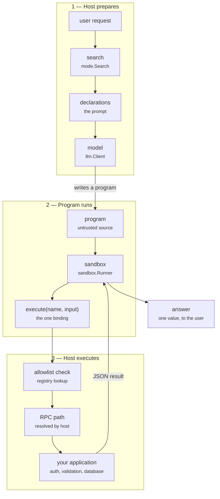
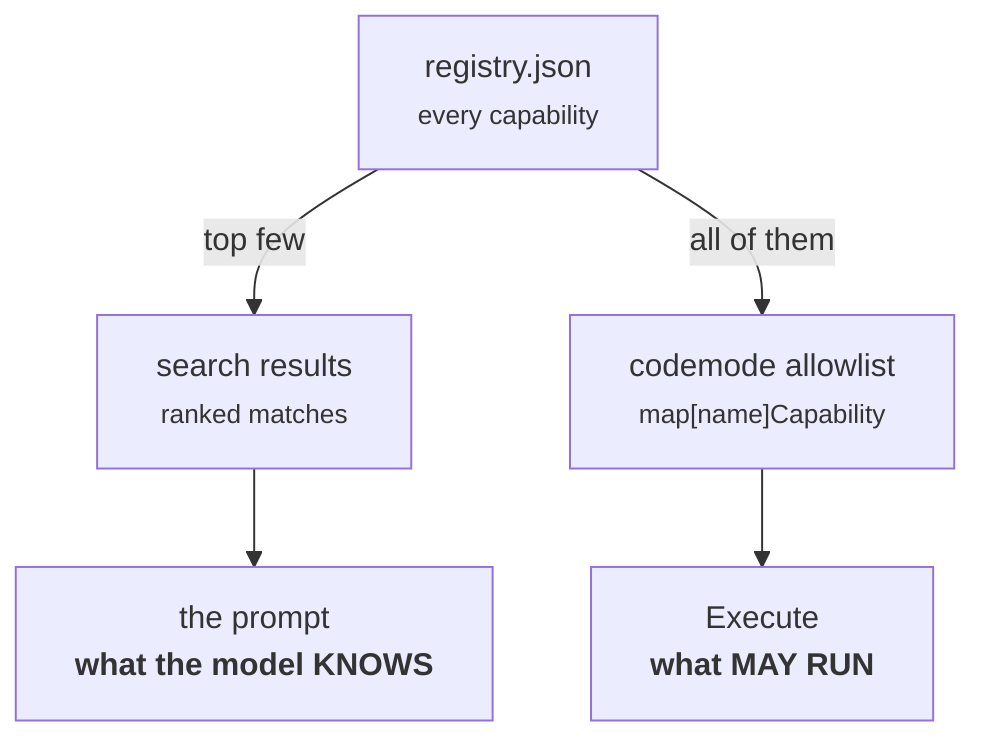
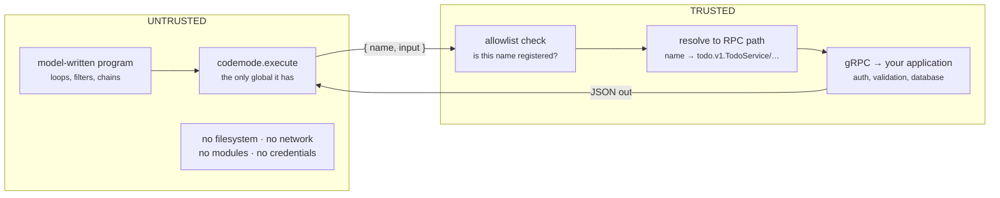
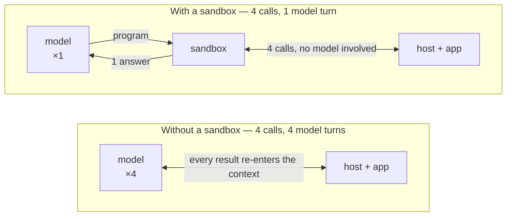

# The flow, step by step

A model writes a small program. The program runs in a sandbox. Every time it
wants something real, it calls back to Go, and Go decides whether to allow it.
Here is that trip, one step at a time.

## The whole path



The arrow back from your application is the part that matters: a result returns
**into the running program**, not into the model. The program can call again and
again before anyone asks the model a second question.

## Before any request: build time

Two things happen long before a user types anything.

### B1 — Protobuf files describe your services

You write `proto/todo.proto` as normal, with two extra annotations: a namespace
on the service and a description on each method. The description is what a model
will read later, so write it for a reader, not a compiler.

### B2 — The generator turns them into a registry

`make generate` asks Buf for a descriptor set, then `registry/main.go` walks it
and writes `registry/registry.json`. Each entry has a friendly `name` like
`todos.complete`, the real `rpc` path `todo.v1.TodoService/Complete`, the
description, and the input and output field types.

Full detail in [Capabilities](/capabilities).

## The eight steps of a request

### 1. A request arrives

Someone says *"add two todos and finish the first one."* Go takes it from here.
Nothing has been sent to a model yet.

### 2. Search picks the relevant capabilities

`mode.Search` ranks the registry against the request and returns the best few
matches. With a database configured this is real semantic search — the request is
embedded into a vector and compared by cosine distance. Without one, the demo
falls back to counting keywords.

Search runs **on the host, before the model exists in the picture**. That
ordering is deliberate, and step 4 explains why.

### 3. Matches become a prompt

Each match is rendered as a call signature with its description above it. Add the
house rules and that is the entire system prompt.

```js
/** Marks a todo item as completed by ID. */
codemode.execute(name: "todos.complete", input: { id: number }): { todo: Todo };
```

Field order is sorted, so the same match set always produces the same bytes and
the prompt stays cacheable.

### 4. The model writes a program

The prompt and the request go to whichever provider is configured. Back comes a
few lines of code. It is ordinary code — no magic, no framework:

```js
const { todos } = codemode.execute("todos.list", {});
const pending = todos.filter(todo => !todo.completed);
const done = codemode.execute("todos.complete", { id: pending[0].id });
return "completed " + done.todo.title;
```

That is JavaScript because the JavaScript engine is configured. The engine writes
its own prompt, so with `SANDBOX_ENGINE=lua` the model is asked for Lua instead
and the same job comes back as `ipairs` and `..`. Steps 1–3 and 6–8 do not change.

Note what the model was *told* versus what it can *run*. Those are two different
lists.



Because they are separate, a program can succeed at calling something search
never surfaced — and a program that invents `todos.purge` is rejected by the map
lookup regardless of the prompt.

### 5. The sandbox runs the program

A fresh interpreter is created for this one run. Its global scope contains
exactly what Go put there and nothing else: no `require`, no `fetch`, no
filesystem. There is one object, `codemode`, with one method, `execute`.

Two bounds are enforced from outside the program: a wall-clock timeout and a cap
on how many capability calls it may make. A program that loops forever is
interrupted; a program that tries a thousand calls is stopped at the budget.

### 6. Each call crosses back into Go

`codemode.execute` is not JavaScript. It is a Go function bound into the
interpreter. When the program calls it, the interpreter blocks, Go takes over,
and the program resumes only when Go returns a value.



This is the only channel. Whatever the program computes, the only way it affects
the outside world is by putting a name and some JSON through this one function.

### 7. Go checks, resolves, and calls

Three things happen in order, and the order matters. **Check** the name against
the registry map — an unknown name is an error and the program never reaches the
network. **Resolve** it to the real protobuf path. **Call** the trusted transport
with that path and the JSON.

Your application is untouched by any of this. Per-user authorization belongs
here, in the transport, not in the prompt.

### 8. The answer comes back

The response is decoded and handed to the waiting program as a plain object. The
program keeps going — filtering it, looping over it, calling again. When it
finally returns, that single value is the answer to the user.

If the program throws, the error is fed back to the model along with the source
that failed, and it gets another attempt. Three by default. Transport errors are
not retried this way — only mistakes the model can actually fix.

## Why bother with a sandbox at all

A fair question: if Go performs the gRPC call regardless, what is the sandbox
buying? The answer is not security — it is arithmetic.



The host does identical work in both lanes. What changes is how many times the
model is paid to read the middle of the job.

The isolation is the *price* of letting model-written code run at all. The
round-trip collapse is the point.

## Who enforces what

A useful habit: for any rule you care about, name the component that enforces it.
If the answer is "the prompt", it is not enforced.

| Guarantee | Enforced by | Not by |
| --- | --- | --- |
| Only registered capabilities run | The registry map in `codemode.Execute` | The prompt |
| No filesystem, network, or modules | The sandbox's empty global scope | Instructions to the model |
| Programs terminate | Timeout and call budget on the runner | Well-behaved generated code |
| Input matches the schema | Your application, at the RPC boundary | The types in the prompt |
| This user may do this thing | Your transport, or a bridge in front of it | Anything described here |
| Secrets stay secret | They live host-side and never enter the sandbox | The program choosing not to look |
