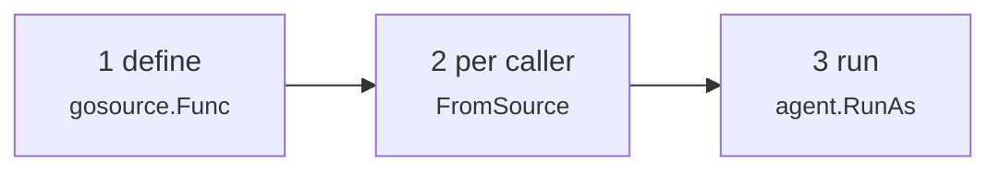
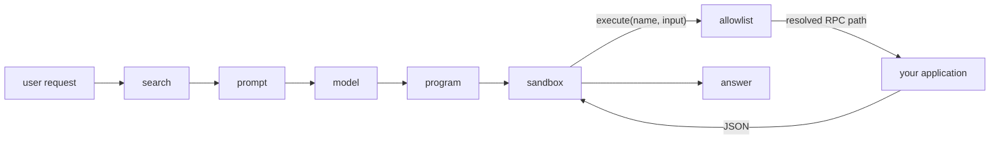

## Use it in your app

Three steps take the Go functions you already have to a model answering
questions with them.



**1. Define capabilities from typed functions.** The structs are the schema;
access is required, and writes can wait for a person.

```go
source, err := gosource.New(
	gosource.Func("orders.list", "Lists orders, optionally only those in one status.",
		gosource.Public(), shop.List, gosource.ReadOnly()),
	gosource.Func("orders.refund", "Refunds a paid order by ID.",
		gosource.Roles("support"), shop.Refund, gosource.NeedsApproval()),
)
```

**2. Narrow to the caller, per request.** What they may not call is withheld
from the prompt and refused at run time.

```go
mode, err := codemode.FromSource(source, capability.Caller{Roles: user.Roles})
```

**3. Run a request, and get a struct back.**

```go
revenue, result, err := agent.RunAs[Revenue](ctx, mode, model,
	"how much have paid orders brought in?", agent.Options{Runner: runner})
```

`model` comes from `llm.NewFromEnv()` and `runner` from
`sandbox.NewFromEnv(sandbox.Options{})`. The [Quickstart](/quickstart) builds all
of this as complete files in ten minutes. Already have protos or MCP servers?
See [Capability sources](/sources).

## In one screen



The model is asked once. Everything between the first call and the last happens
inside the sandbox, and every capability call is checked against the registry
before it reaches your code.

## Try it without configuring anything

With no API keys and no database, the whole path still runs — search falls back
to keyword ranking and a fixed program stands in for the model.

```sh
mise install
make demo-todo
```

Then give a model the pen:

```sh
export ANTHROPIC_API_KEY=...
go run ./examples/todo -request "finish anything about docs"
```

Or run the complete one — a task tracker with a web UI, SQLite storage,
per-user scoping, and charts rendered from a prompt. It talks to any
OpenAI-compatible endpoint:

```sh
go run ./examples/taskreport -serve :8080 \
  -base-url https://api.deepseek.com/v1 -api-key sk-... -model deepseek-chat
```

Read [what code mode is](/overview) for the idea, [Architecture](/architecture)
for how the pieces fit, or [the flow](/flow) for one request traced step by step.
