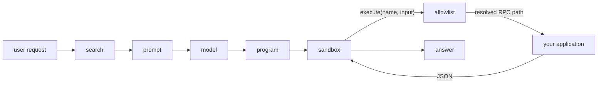

## In one screen



The model is asked once. Everything between the first call and the last happens
inside the sandbox, and every capability call is checked against the registry
before it reaches your code.

## Try it without configuring anything

With no API keys and no database, the whole path still runs — search falls back
to keyword ranking and a fixed program stands in for the model.

```sh
mise install
make demo-todo
```

Then give a model the pen:

```sh
export ANTHROPIC_API_KEY=...
go run ./examples/todo -request "finish anything about docs"
```

Or run the complete one — a task tracker with a web UI, SQLite storage,
per-user scoping, and charts rendered from a prompt:

```sh
go run ./examples/taskreport -serve :8080
```

Start with [what code mode is](/overview), go straight to
[the flow](/flow) if you would rather see the mechanism first, or skip to
[adding it to your application](/using-it) if you already know what you want.
