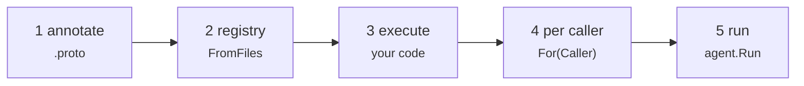
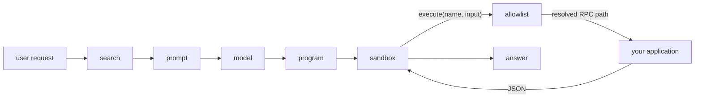

## Use it in your app

Five steps take an application from protobuf contracts to a model answering
questions against them. Only step 3 is code nobody can write for you.



**1. Annotate the contract.** A namespace on the service, a description on each
method. That is all a model will ever read about it.

```proto
service OrderService {
  option (codemode.namespace) = "orders";
  rpc List(ListRequest) returns (ListResponse) {
    option (codemode.description) = "Lists orders, optionally filtered by status.";
  }
}
```

**2. Derive the registry** from the generated Go. No file to keep in sync.

```go
full, err := registry.FromFiles(ordersv1.File_orders_v1_orders_proto)
```

**3. Write `ExecuteFunc`.** It receives an RPC path and JSON input, and calls
your service layer the way your HTTP handlers already do.

```go
func execute(ctx context.Context, rpc string, input json.RawMessage) (json.RawMessage, error) {
	switch rpc {
	case "orders.v1.OrderService/List":
		return listOrders(ctx, input) // identity comes from ctx, never from input
	}
	return nil, fmt.Errorf("RPC %q is not implemented", rpc)
}
```

**4. Narrow to the caller, per request.** What they may not call is withheld
from the prompt and refused at run time.

```go
allowed := full.For(capability.Caller{Roles: user.Roles, Permissions: user.Permissions})
mode, err := codemode.New(allowed, capability.Keyword(allowed), execute)
```

**5. Run a request.**

```go
result, err := agent.Run(ctx, mode, model, "how much have paid orders brought in?",
	agent.Options{Runner: runner})
fmt.Println(agent.Answer(result.Answer))
```

`model` comes from `llm.NewFromEnv()` and `runner` from
`sandbox.NewFromEnv(sandbox.Options{})`. The [Quickstart](/quickstart) builds all
of this as complete files in fifteen minutes; the [Integration guide](/using-it)
explains every choice; [Adding it to an existing app](/existing-app) walks a real
CRM through it.

## In one screen



The model is asked once. Everything between the first call and the last happens
inside the sandbox, and every capability call is checked against the registry
before it reaches your code.

## Try it without configuring anything

With no API keys and no database, the whole path still runs — search falls back
to keyword ranking and a fixed program stands in for the model.

```sh
mise install
make demo-todo
```

Then give a model the pen:

```sh
export ANTHROPIC_API_KEY=...
go run ./examples/todo -request "finish anything about docs"
```

Or run the complete one — a task tracker with a web UI, SQLite storage,
per-user scoping, and charts rendered from a prompt. It talks to any
OpenAI-compatible endpoint:

```sh
go run ./examples/taskreport -serve :8080 \
  -base-url https://api.deepseek.com/v1 -api-key sk-... -model deepseek-chat
```

Read [what code mode is](/overview) for the idea, [Architecture](/architecture)
for how the pieces fit, or [the flow](/flow) for one request traced step by step.
