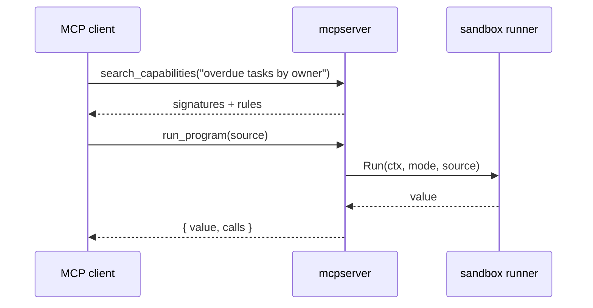

# Serving MCP clients

`mcpserver` puts a `CodeMode` behind the Model Context Protocol, so Claude Code,
Claude Desktop, Cursor or any other MCP client can use your capabilities.

It does not register one MCP tool per RPC. It registers two, whatever the size
of the registry:

| Tool | Does |
| --- | --- |
| `search_capabilities(query, limit?)` | `mode.Search`, rendered with `runner.Prompt`: the language rules, an example, and the signatures that match |
| `run_program(source)` | `runner.Run` in the sandbox; returns `{ value, calls }` |

The client's own model writes the program. Only the capabilities a search
returned enter its context, and intermediate results stay in the sandbox: the
model sees the final value, not every row it filtered.



## Wiring

The server needs your `ExecuteFunc`, so there is no generic binary: you build one
the same way you build `mode` for `agent.Run`. `mcpserver.New` takes a function
that returns the runtime for whoever made each tool call.

### One user, over stdio

A stdio server is started by one person's MCP client and serves only them, so
one runtime is enough:

```go
mode, _ := codemode.New(registry.For(caller), search, execute) // caller: this user's roles and permissions
runner, _ := sandbox.New(sandbox.Options{Engine: "goja", Isolation: "process"})

server, _ := mcpserver.New(mcpserver.Static(mode), runner, mcpserver.Options{Name: "tasks"})
server.Run(ctx, &mcp.StdioTransport{})
```

Stdout belongs to the protocol; log to stderr. A role change applies when the
client restarts the server.

`examples/todo/cmd/todo-mcp` is a complete server. Register it with Claude Code:

```sh
make worker
claude mcp add todo -- make -s -C /path/to/codemode mcp-todo
```

### Many users, over HTTP

One server for everyone: each tool call builds that caller's runtime from their
own roles and permissions, fetched from your app, exactly as a web request would.

```go
modeFor := func(ctx context.Context, request *mcp.CallToolRequest) (codemode.CodeMode, error) {
	// request.Extra.TokenInfo is set by auth.RequireBearerToken; Header has the raw request headers.
	caller, err := app.CallerFor(ctx, request.Extra.TokenInfo) // your app: roles and permissions, fetched now
	if err != nil {
		return nil, err // fail closed: the call returns a tool error
	}
	allowed := full.For(caller)
	return codemode.New(allowed, capability.Keyword(allowed), app.ExecuteFor(caller))
}

server, _ := mcpserver.New(modeFor, runner, mcpserver.Options{Name: "crm"})
handler := mcp.NewStreamableHTTPHandler(func(*http.Request) *mcp.Server { return server }, nil)
http.Handle("/mcp", auth.RequireBearerToken(app.VerifyToken, nil)(handler))
```

- `modeFor` runs on **every** tool call, so a role an admin edits applies on the
  user's next call, mid-session, with nothing restarted.
- Verify the token in `auth.RequireBearerToken` (from the MCP SDK's `auth`
  package), not in `modeFor`: an unauthenticated request then never reaches a tool.
- Return an error from `modeFor` for an unknown or revoked user. The call fails
  as a tool error; nothing runs.
- Bind the user into `ExecuteFor(caller)` too, so the calls a program makes reach
  your app as that user (for an HTTP backend, with their own token).

A test runs this over real HTTP with two users holding different permissions,
changes one user's role between calls, and rejects an unknown caller
(`TestEachCallSeesItsCallersCapabilities` in `mcpserver`).

## Security

- **The caller's roles come from your app, never from the client.** No tool
  argument names a role or permission, so a client cannot widen what its
  registry allows. Over HTTP, `modeFor` decides per call from the verified token.
- **Use process isolation** (`SANDBOX_ISOLATION=process`). An MCP client is a program author you do not
  control; see [Running the worker](/worker).
- `Options.MaxSourceBytes` (64 KiB) bounds the program; `sandbox.Options` bounds
  calls, time and each response. For MCP, a smaller `MaxResponseBytes` keeps
  results from flooding the client's context.
- Program errors come back as tool errors (`isError`), so the client's model can
  read them and retry.
