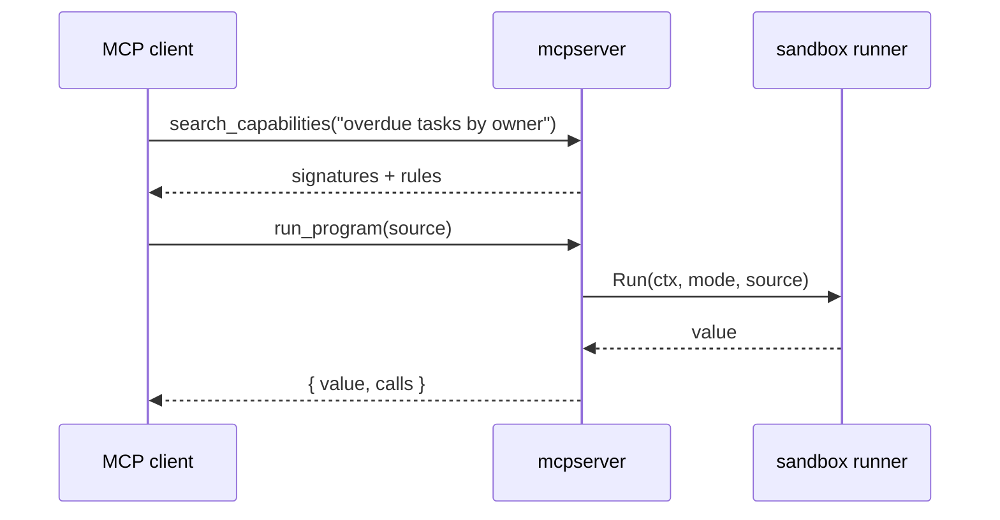

# Serving MCP clients

`mcpserver` puts a `CodeMode` behind the Model Context Protocol, so Claude Code,
Claude Desktop, Cursor or any other MCP client can use your capabilities.

It does not register one MCP tool per RPC. It registers two, whatever the size
of the registry:

| Tool | Does |
| --- | --- |
| `search_capabilities(query, limit?)` | `mode.Search`, rendered with `runner.Prompt`: the language rules, an example, and the signatures that match |
| `run_program(source)` | `runner.Run` in the sandbox; returns `{ value, calls }` |

The client's own model writes the program. Only the capabilities a search
returned enter its context, and intermediate results stay in the sandbox: the
model sees the final value, not every row it filtered.



## Wiring

The server needs your `ExecuteFunc`, so there is no generic binary: you build one
the same way you build `mode` for `agent.Run`.

```go
mode, _ := codemode.New(registry.For(caller), search, execute) // caller: this user's roles and permissions
runner, _ := sandbox.New(sandbox.Options{Engine: "goja", Isolation: "process"})

server, _ := mcpserver.New(mode, runner, mcpserver.Options{Name: "tasks"})
server.Run(ctx, &mcp.StdioTransport{})
```

Stdout belongs to the protocol; log to stderr.

`examples/todo/cmd/todo-mcp` is a complete server. Register it with Claude Code:

```sh
make worker
claude mcp add todo -- make -s -C /path/to/codemode mcp-todo
```

## Security

- **The roles are fixed when you build `mode`.** No tool argument names a role,
  so a client cannot widen what the registry allows. A stdio server runs for one
  user: fetch that user's roles or permissions from your app at startup and pass
  them to `For`. A role change then applies when the client restarts the
  server.
- **Use a subprocess engine.** An MCP client is a program author you do not
  control; see [Running the worker](/worker).
- `Options.MaxSourceBytes` (64 KiB) bounds the program; `sandbox.Options` bounds
  calls, time and each response. For MCP, a smaller `MaxResponseBytes` keeps
  results from flooding the client's context.
- Program errors come back as tool errors (`isError`), so the client's model can
  read them and retry.
