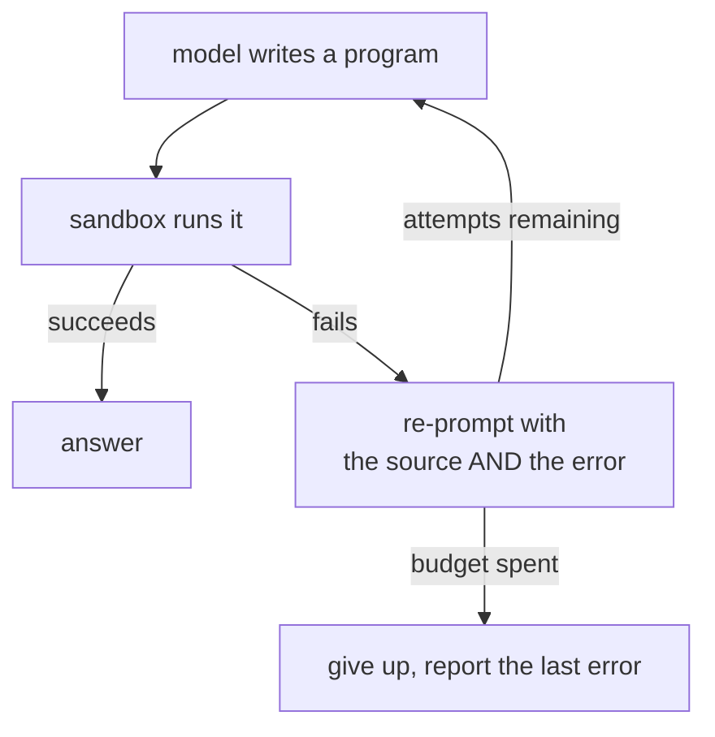

# Models

The model's only job is to turn a request plus a list of capabilities into a
program. It never touches your application, never sees an RPC path, and is asked
exactly once per attempt.

## The interface

```go
type Client interface {
    Complete(ctx context.Context, system, user string) (string, error)
    Name() string
}
```

`llm.New()` builds one from the environment and returns `llm.ErrNoProvider` when
nothing is configured, so a caller with a fallback path can check for it with
`errors.Is`.

## Choosing a provider

```sh
LLM_PROVIDER=claude          # or openai
ANTHROPIC_API_KEY=...        # ANTHROPIC_MODEL defaults to claude-opus-5
OPENAI_API_KEY=...           # OPENAI_MODEL defaults to gpt-5
```

Leave `LLM_PROVIDER` unset and whichever provider is configured is used, Claude
first. Set nothing at all and the Todo demo runs a fixed program instead.

## Any compatible endpoint

Both providers accept a base URL, so self-hosted and third-party models reach you
through the same two code paths:

```sh
LLM_BASE_URL=http://localhost:11434/v1     # for whichever provider is selected
OPENAI_BASE_URL=...                        # per-provider, wins over the above
ANTHROPIC_BASE_URL=...
```

A base URL may be set **without an API key** — local endpoints often do not
authenticate. And a bare `LLM_BASE_URL` with no provider selected defaults to
`openai`, since most compatible endpoints speak that protocol.

That covers Ollama, vLLM, LM Studio, OpenRouter, Together, Groq, and internal
gateways.

::: tip One behaviour difference
Against a custom Claude base URL, the server-side fallback beta is not sent — a
proxy or compatible server is unlikely to implement it, and an unknown field
would fail the request outright. Direct Anthropic still gets it.
:::

## What the model is sent

Two strings. A system prompt written by the sandbox engine, and the user's
request.

The system prompt is the engine's rules plus the declarations for the capabilities
search selected. Because the engine writes it, switching `SANDBOX_ENGINE` changes
the language the model is asked for and nothing else — see [Sandbox](/sandbox).

The declarations are sorted, so the same match set produces byte-identical
prompts and prompt caching works. On Claude, the system block additionally
carries a cache control marker.

## The repair loop



`agent.Run` generates a program, runs it, and on a sandbox failure re-prompts with
both the failed source and the error text. Three attempts by default.

Transport errors — a 429, a dropped connection — are **not** retried this way.
Only failures the model can actually fix go back into the loop.

## Using it

```go
model, err := llm.New()
if errors.Is(err, llm.ErrNoProvider) {
    // fall back, or tell the user what to set
}

result, err := agent.Run(ctx, mode, model, request, agent.Options{})
fmt.Println(agent.Answer(result.Answer))
```

`agent.Result` carries the answer, the program that produced it, the capabilities
that were described to the model, and how many attempts it took.

## Model responses are untrusted input

Two habits worth keeping:

- **Strip fences.** Models add markdown fences even when told not to.
  `agent.Program` handles it; do the same if you call a provider directly.
- **Never eval a response outside the sandbox.** The entire design assumes the
  program runs behind [the boundary](/flow#_6-each-call-crosses-back-into-go).
