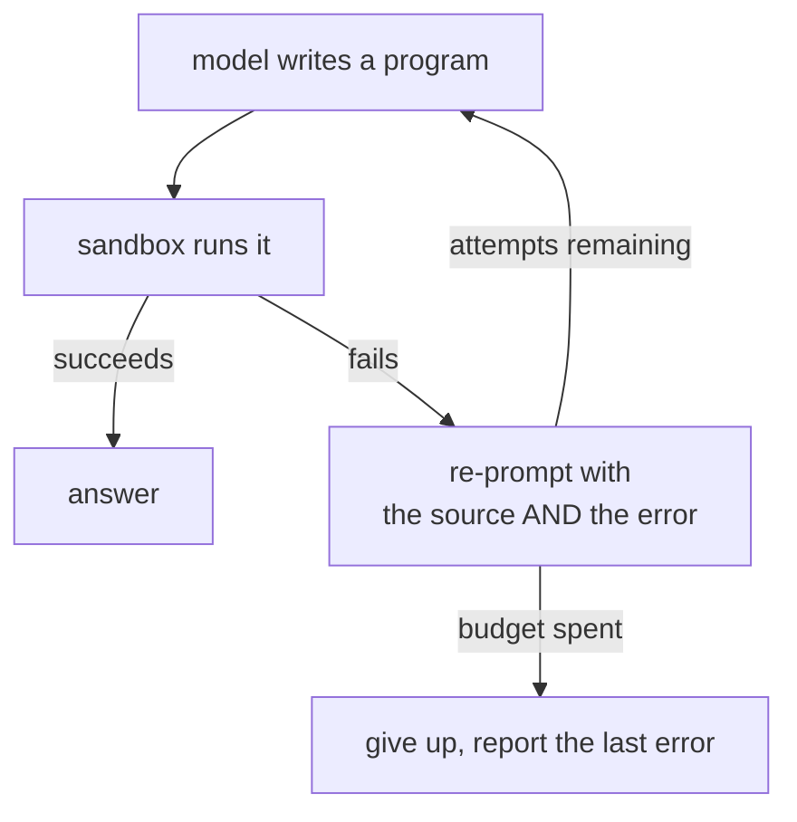

# Models

The model's only job is to turn a request plus a list of capabilities into a
program. It never touches your application, never sees an RPC path, and is asked
exactly once per attempt.

## The interface

```go
type Client interface {
    Complete(ctx context.Context, system, user string) (string, error)
    Name() string
}
```

A client may also implement `llm.Streamer`, which delivers the response in
pieces as the model writes it. It is an optional interface, so a client without
it still works everywhere — see [Streaming](#streaming) below.

`llm.New(options)` builds one from an explicit `llm.Options`. `llm.NewFromEnv()`
reads the environment first, and returns `llm.ErrNoProvider` when
nothing is configured, so a caller with a fallback path can check for it with
`errors.Is`.

## Choosing a provider

```sh
LLM_PROVIDER=claude          # or openai
ANTHROPIC_API_KEY=...        # ANTHROPIC_MODEL defaults to claude-opus-5
OPENAI_API_KEY=...           # OPENAI_MODEL defaults to gpt-5
```

Leave `LLM_PROVIDER` unset and whichever provider is configured is used, Claude
first. Set nothing at all and the Todo demo runs a fixed program instead.

## Any compatible endpoint

Both providers accept a base URL, so self-hosted and third-party models reach you
through the same two code paths:

```sh
LLM_BASE_URL=http://localhost:11434/v1     # for whichever provider is selected
OPENAI_BASE_URL=...                        # per-provider, wins over the above
ANTHROPIC_BASE_URL=...
```

A base URL may be set **without an API key** — local endpoints often do not
authenticate. And a bare `LLM_BASE_URL` with no provider selected defaults to
`openai`, since most compatible endpoints speak that protocol.

That covers Ollama, vLLM, LM Studio, OpenRouter, Together, Groq, and internal
gateways.

## Configuring the model

`llm.New` takes an `llm.Options`. Every field is optional, and **anything you set
wins over the environment** — deployment configuration should not silently
override a decision the application made deliberately.

```go
model, err := llm.New(llm.Options{
	Model:     "claude-sonnet-5",
	MaxTokens: 8000,
	Timeout:   45 * time.Second,
})
```

| Field | Falls back to | Then |
| --- | --- | --- |
| `Provider` | `LLM_PROVIDER` | whichever provider is configured |
| `Model` | `ANTHROPIC_MODEL` / `OPENAI_MODEL` | the provider's default |
| `APIKey` | `ANTHROPIC_API_KEY` / `OPENAI_API_KEY` | — |
| `BaseURL` | `ANTHROPIC_BASE_URL` / `OPENAI_BASE_URL` | `LLM_BASE_URL` |
| `MaxTokens` | `LLM_MAX_TOKENS` | 16000 |
| `Temperature` | `LLM_TEMPERATURE` | unset — the provider's own default |
| `TopP` | `LLM_TOP_P` | unset |
| `Timeout` | `LLM_TIMEOUT` | the SDK's default |
| `StopSequences` | — | unset |

A field a provider does not support is ignored rather than rejected, so the same
`Options` can be handed to whichever provider the environment picks.

::: warning Temperature turns Claude's thinking off
Anthropic rejects a temperature or `top_p` alongside extended thinking, so
setting either one disables it. Programs are measurably better with thinking
than with a tuned temperature — leave both nil unless you have a reason.

`Temperature` is a `*float64` precisely because `0` is a real setting. Use
`llm.Float(0)`; a plain zero value means "unset".
:::

### Provider-specific settings

Each provider package has its own `Options` embedding `llm.Options`, for knobs
the other one has no equivalent of:

```go
import "github.com/mukezhz/codemode/llm/claude"

model, err := claude.New(claude.Options{
	Options:  llm.Options{Model: "claude-opus-5"},
	Thinking: claude.ThinkingAdaptive,
	Request:  []option.RequestOption{option.WithMaxRetries(5)},
})
```

| Package | Fields |
| --- | --- |
| `llm/claude` | `Thinking`, `Fallbacks`, `Betas`, `Request` |
| `llm/openai` | `ReasoningEffort`, `Seed`, `Request` |

`Request` is the escape hatch: raw SDK request options for retries, headers, or
a custom HTTP client — anything these structs do not model.

## Adding to the prompt

The system prompt belongs to the sandbox engine, because it describes the
language and the single binding the program is evaluated against. A prompt
without those produces code the sandbox cannot run.

To add domain guidance on top, use `agent.Options.Instructions`. It is appended
after the engine's rules and the capability declarations:

```go
result, err := agent.Run(ctx, mode, model, request, agent.Options{
	Instructions: "Prefer todos.list over todos.search. Answer in one sentence.",
})
```

To take over the prompt entirely, drive the loop yourself — `runner.Prompt`
gives you the same base to build on. See
[driving it yourself](/using-it#driving-it-yourself).

::: tip One behaviour difference
Against a custom Claude base URL, the server-side fallback beta is not sent — a
proxy or compatible server is unlikely to implement it, and an unknown field
would fail the request outright. Direct Anthropic still gets it.
:::

## What the model is sent

Two strings. A system prompt written by the sandbox engine, and the user's
request.

The system prompt is the engine's rules plus the declarations for the capabilities
search selected. Because the engine writes it, switching `SANDBOX_ENGINE` changes
the language the model is asked for and nothing else — see [Sandbox](/sandbox).

The declarations are sorted, so the same match set produces byte-identical
prompts and prompt caching works. On Claude, the system block additionally
carries a cache control marker.

## The repair loop



`agent.Run` generates a program, runs it, and on a sandbox failure re-prompts with
both the failed source and the error text. Three attempts by default.

Transport errors — a 429, a dropped connection — are **not** retried this way.
Only failures the model can actually fix go back into the loop.

## Using it

```go
model, err := claude.New(claude.Options{Options: llm.Options{APIKey: config.Key}})
if err != nil {
    return err
}

runner, err := goja.New(sandbox.Options{})
if err != nil {
    return err
}
defer runner.Close()

result, err := agent.Run(ctx, mode, model, request, agent.Options{Runner: runner})
fmt.Println(agent.Answer(result.Answer))
```

`agent.Options.Runner` is required. This package builds nothing from the
environment on your behalf, so the engine an untrusted program runs in is always
a decision you made — `sandbox.NewFromEnv` is there when you want
`SANDBOX_ENGINE` to make it.

To read the environment instead of configuring in code:

```go
model, err := llm.NewFromEnv()
if errors.Is(err, llm.ErrNoProvider) {
    // fall back, or tell the user what to set
}
```

`agent.Result` carries the answer, the program that produced it, the capabilities
that were described to the model, how many attempts it took, whether it came from
the [cache](/caching), and a `Timing` breakdown of where the time went.

## Streaming

A model call takes seconds and nothing on your side makes it shorter. Streaming
does not change that — it changes what those seconds look like, turning a blank
screen into a program appearing a line at a time.

```go
type Streamer interface {
    CompleteStream(ctx context.Context, system, user string, chunk func(string)) (string, error)
}
```

Both shipped providers implement it. Ask for it through the agent:

```go
result, err := agent.Run(ctx, mode, model, request, agent.Options{
    Runner:  runner,
    OnChunk: func(piece string) { fmt.Print(piece) },
})
```

Concatenating every chunk gives the same text `Complete` would have returned. A
model that does not implement `Streamer` is not an error: `OnChunk` never fires
and the program arrives in one piece.

Three things to know:

- **`OnChunk` runs on the goroutine driving the request** and must not block. The
  stream is not read while it runs, so push to a channel or a response writer
  rather than doing work there.
- **Repair attempts stream too.** A caller displaying the program should reset
  its buffer when `Result.Attempts` changes, or the second attempt appends to the
  first.
- **A wrapper must forward it.** A value stored in an interface loses the methods
  that interface does not name, so a traced or instrumented `llm.Client` that does
  not implement `Streamer` turns streaming off for everything behind it.

```go
func (wrapper *traced) CompleteStream(ctx context.Context, system, user string, chunk func(string)) (string, error) {
    streamer, ok := wrapper.inner.(llm.Streamer)
    if !ok {
        return wrapper.Complete(ctx, system, user)
    }
    return streamer.CompleteStream(ctx, system, user, chunk)
}
```

`examples/taskreport` streams over server-sent events at `POST /api/chat/stream`,
and logs time-to-first-chunk next to the total — the number that says whether a
slow provider is thinking or merely producing a lot of output. See
[Latency](/latency#time-to-first-chunk).

## Model responses are untrusted input

Two habits worth keeping:

- **Strip fences.** Models add markdown fences even when told not to.
  `agent.Program` handles it; do the same if you call a provider directly.
- **Never eval a response outside the sandbox.** The entire design assumes the
  program runs behind [the boundary](/flow#_6-each-call-crosses-back-into-go).
