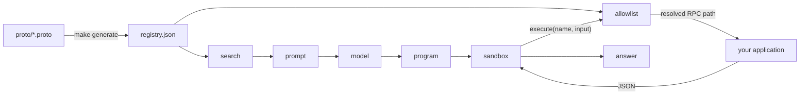

# What code mode is

Ordinary tool use makes a model do the work one call at a time. Ask it to finish
fifty tasks and you get fifty round trips, with every intermediate result passing
back through the model.

Code mode flips that. The model writes a **program** instead of a call. The
program loops, filters, and chains at machine speed inside a sandbox, and only
the final answer comes back. The model is asked once.

The sandbox cannot reach your database, your network, or your secrets. It gets
exactly one function, and that function goes back to Go, which checks a registry
before letting anything run.

## The shape of it



Two things come out of the registry, and keeping them apart is the whole security
story. Search decides what the model *knows about*. The allowlist decides what
may actually *run*. A program that invents a capability name is rejected by a map
lookup, no matter how convincing the prompt was.

## What you write, what you get

You write protobuf service definitions with two annotations. Everything else is
generated or configured.

```proto
service TodoService {
  option (code_mode.namespace) = "todos";

  rpc Complete(CompleteRequest) returns (CompleteResponse) {
    option (code_mode.description) = "Marks a todo item as completed by ID.";
  }
}
```

From that, a model can be handed a working program to write:

```js
const { todos } = codemode.execute("todos.list", {});
const pending = todos.filter(todo => !todo.completed);
codemode.execute("todos.complete", { id: pending[0].id });
return "completed " + pending[0].title;
```

Your application never changes. It validates its own input, enforces its own
permissions, and owns what "complete" actually means.

## Three swappable parts

Each is an interface with more than one implementation, chosen by an environment
variable. Nothing else in the system knows which is in play.

| Piece | Interface | Options | Variable |
| --- | --- | --- | --- |
| Search | `capability.Store` | sqlite-vector, pgvector | `CAPABILITY_DB` |
| Model | `llm.Client` | Claude, OpenAI + compatible | `LLM_PROVIDER` |
| Sandbox | `sandbox.Runner` | JavaScript, Starlark, Lua | `SANDBOX_ENGINE` |

The sandbox engine also writes its own prompt, so choosing one chooses the
language the model is asked to write in — and nothing upstream notices.

## Run it

With no keys and no database, everything still runs: search falls back to
keywords and a fixed program stands in for the model, so you can watch the whole
path without credentials.

```sh
make demo-todo
```

With a model actually writing the program:

```sh
export ANTHROPIC_API_KEY=...
go run ./examples/todo -request "finish anything about docs"
```

## Where to go next

- [The flow, step by step](/flow) — one request from plain English to a real RPC.
- [Capabilities](/capabilities) — writing contracts and generating the registry.
- [Configuration](/configuration) — every environment variable in one table.

::: warning The sandbox is not a security boundary
All three engines run in-process. They deny ambient capabilities and bound time
and call count, which is right for code your own host asked a model to write.
Before running programs authored for untrusted end users, implement `Runner` over
a separate process or a container. See [Sandbox](/sandbox#the-isolation-ladder).
:::
