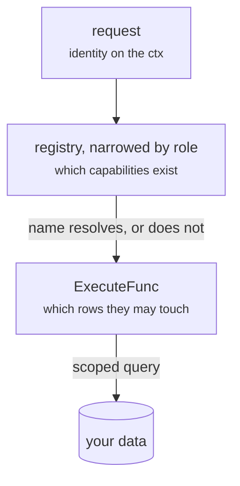

# Many services, many users

Two questions come up the moment a real application appears. How do dozens of
proto files across a dozen subsystems become one registry? And how does a task
that belongs to one person stay that way, when the program asking for it was
written by a model?

They have different answers, and mixing them up is where the mistakes are.

## Many proto files

`registry.FromFiles` is variadic, and `capability.Merge` joins registries that
were built separately. A CRM assembles like this:

```go
func capabilities() (capability.Registry, error) {
	contacts, err := registry.FromFiles(contactv1.File_contact_proto)
	if err != nil {
		return capability.Registry{}, err
	}
	deals, err := registry.FromFiles(dealv1.File_deal_proto, pipelinev1.File_pipeline_proto)
	if err != nil {
		return capability.Registry{}, err
	}
	billing, err := registry.FromFiles(invoicev1.File_invoice_proto)
	if err != nil {
		return capability.Registry{}, err
	}
	return capability.Merge(contacts, deals, billing)
}
```

Better still, let each subsystem own its own function — `crm.Capabilities()`,
`billing.Capabilities()` — so adding a proto file is a change in one package
rather than an edit to a central list.

**Namespaces are the boundary.** The `(codemode.namespace)` option on each
service is what keeps `contacts.list` and `deals.list` apart, and `Merge`
rejects a name claimed twice rather than letting the last one win. Two teams
colliding is then a startup failure with both names in the message, not a model
calling the wrong code in production.

`Merge` is not required. One `FromFiles(a, b, c, …)` call listing every file
works and does the same duplicate checking. Merge earns its place when the
registries come from different sources — some from descriptors, one loaded from
JSON, one built by hand for a plugin.

::: tip Search matters more as this grows
Below roughly twenty capabilities you can describe all of them in every prompt.
A CRM with two hundred cannot, and word-overlap ranking stops being enough —
"who has not been called back?" shares no words with "contacts.staleSince". That
is where [semantic search](/search) starts paying for itself.
:::

## Many users

The second question is the one with a wrong answer that looks right.

::: danger Never put "who is asking" in a request message
If `tasks.list` takes an `owner`, then the program can set it. A program written
by a model is untrusted input — the same as a query string from a browser. The
first thing to try is someone else's name.

The identity travels on the `context.Context`, put there by the transport after
verifying a token, and read inside `ExecuteFunc`. There is no field for it in
any proto, so there is nothing for a program to set.
:::

```go
// The transport puts the verified identity on the context.
ctx = auth.NewContext(ctx, identity)

func (app *App) Execute(ctx context.Context, rpc string, input json.RawMessage) (json.RawMessage, error) {
	identity, err := auth.From(ctx)
	if err != nil {
		return nil, err  // a missing identity is a wiring bug: stop
	}
	scope := store.Only(identity.User)
	if identity.Admin() {
		scope = store.Everyone()
	}
	// every branch below passes scope to the store
}
```

## Two locks, doing different jobs



**The registry decides which capabilities exist.** It is data, and building
another is cheap, so build one per caller:

```go
var adminOnly = capability.Named("users.list", "tasks.assign", "reports.byOwner")

allowed := full
if !identity.Admin() {
	allowed = full.Select(func(item capability.Capability) bool { return !adminOnly(item) })
}
mode, err := codemode.New(allowed, search.New(allowed), app.Execute)
```

A member's runtime does not contain `tasks.assign` **at all** — it is missing
from the map `Execute` resolves against, not merely hidden from the model. And
because search is built over the same narrowed registry, the model is never told
about a capability it cannot call.

**The scope decides which rows those capabilities may touch.** The registry
cannot do this: it knows the capability being called and nothing whatsoever
about the data behind it. Only your application knows that a task has an owner.

Neither lock replaces the other. Withholding `tasks.assign` does nothing to stop
`tasks.get` reading a colleague's task; scoping `tasks.get` does nothing to stop
a member reassigning work.

## Rules worth following

**Make the scope a parameter, not a habit.** If every store method takes a
`Scope`, the compiler asks for one at every call site. A filter you have to
remember to add is a filter someone forgets.

```go
func (store *Store) List(scope Scope, filter Filter) ([]Task, error)
```

**Make the zero value reach nothing.** A code path that forgets to build a scope
gets `Scope{}`. That must return no rows, never all of them — fail closed is the
only safe default for the thing standing between two users' data.

**Say "not found", never "forbidden".** A distinct forbidden error lets a
program map out which IDs exist by probing them. Out of scope and non-existent
should be indistinguishable from outside.

**Scope reports too.** A total leaks what a listing does not. `reports.overdue`
returning three when the caller can only see one is a disclosure, in a smaller
package.

**Keep the role check even though the registry already has one.** The registry
is assembled per request from a role, and a bug in that assembly should fail
closed rather than quietly widen what a member sees. It is a cheap second lock
on a door you already locked.

**Derive ownership, never accept it.** `tasks.create` has no `owner` field; the
owner is `identity.User`. A program cannot file work under someone else's name
because there is nothing to set.

## Where it is demonstrated

[`examples/taskreport`](https://github.com/mukezhz/codemode/tree/main/examples/taskreport)
does all of the above with two proto files, three users, and two roles:

```sh
go run ./examples/taskreport -user ada   -role member  # 19 capabilities, own tasks
go run ./examples/taskreport -user grace -role admin   # 23 capabilities, everyone's
```

Its tests are the specification for this page — that a member cannot read a
colleague's task even knowing its ID, that the error does not distinguish
forbidden from missing, that admin capabilities are absent rather than guarded,
and that the guard holds anyway if the registry is wired too wide.
