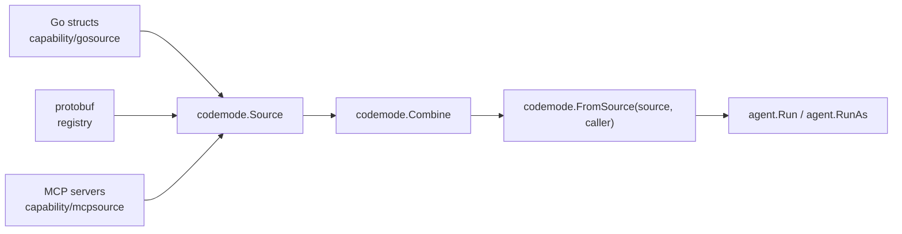

# Capability sources

A capability is a function the model's program may call. Where its definition
comes from is a choice; what codemode guarantees about it is not. Every source
produces the same `codemode.Source`:

```go
type Source struct {
	Registry capability.Registry // what may be called, with its shapes and access
	Execute  codemode.ExecuteFunc // what serves each call
	Skipped  map[string]error     // definitions the adapter could not express
}
```

and from there validation, approval, search, typed answers and the sandbox
behave the same.



## Choosing one

| You have | Use | Why |
| --- | --- | --- |
| Go functions | [`gosource`](/quickstart) | No codegen, no switch; the structs are the schema. Start here. |
| An API described in protobuf | [`registry`](/protobuf) | The contract already exists; roles and approval live in it. |
| A service in another language, or a SaaS | [`mcpsource`](/capabilities#capabilities-from-an-mcp-server) | Run or reuse an MCP server; import its tools. |

## What every capability carries

| Field | Decided by |
| --- | --- |
| Name, description | the provider |
| Input and output shape | the provider |
| Handler | the provider |
| Read or write | the provider proposes, your application decides |
| Access: roles, permissions | your application only |
| Needs approval | your application only |

A provider describes a capability; only your application grants it. That is why
`mcpsource` makes every imported tool require a role you name and treats each as
a write, whatever the server claims, and why `gosource.Func` has no default
access.

## Combining sources

```go
own, err := gosource.New(...)
github, err := mcpsource.Import(ctx, session, "github", "engineer")
proto := codemode.Source{Registry: registry, Execute: app.Execute}

all, err := codemode.Combine(own, github, proto)
mode, err := codemode.FromSource(all, caller)
```

`Combine` routes each call to the source that owns its RPC. A capability name or
RPC defined twice is an error, not a silent override.

`FromSource` is `New` with the defaults: `Registry.For(caller)` and keyword
search. Use `codemode.New` directly for a [vector index](/search).

## Writing an adapter

A new source is a package that returns a `codemode.Source`. In its tests, run the
shared contract:

```go
func TestSourcePassesTheContract(t *testing.T) {
	sourcetest.Run(t, source)
}
```

It checks names and RPCs are unique, every capability has a description and a
declared input shape, every referenced type is declared, and an unknown RPC
fails.
