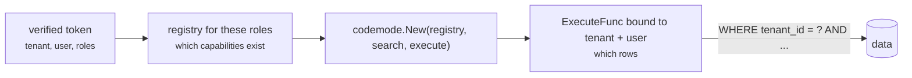

# Roles and tenants

This page builds one request path for a product with many customers (tenants),
many users per tenant, and several roles per user. [Permissions](/permissions)
explains each lock on its own; this page puts them together.

## Three questions, three places

| Question | Example | Answered by | Where |
| --- | --- | --- | --- |
| Which **capabilities exist** for this caller? | a viewer has no `tasks.delete` | roles | `(codemode.roles)` in protos → `Registry.ForRole` / `Select` |
| Which **tenant's data** do they reach? | acme never sees globex rows | the tenant | your `ExecuteFunc` |
| Which **rows inside the tenant**? | a member sees their own tasks, a manager their team's | the user and role | your `ExecuteFunc` |

Codemode answers the first. It has no idea what a tenant is, and that is
deliberate: the second and third live where your data does.



## The identity

Your authentication produces it once per request, from a verified session or
token, never from the request body:

```go
type Identity struct {
	Tenant string
	User   string
	Roles  []string // e.g. ["member"], ["member", "billing"]
}
```

It travels on the `context.Context` into `ExecuteFunc`. No proto message has a
field for any of it, so a program has nothing to set.

## Roles: declare them in the contract

```protobuf
service TaskService {
  option (codemode.namespace) = "tasks";

  rpc List(ListRequest) returns (TaskList) {           // everyone
    option (codemode.description) = "Lists tasks you can see.";
  }
  rpc Assign(AssignRequest) returns (Task) {           // either role
    option (codemode.description) = "Moves a task to another person.";
    option (codemode.roles) = "manager admin";
  }
  rpc Delete(DeleteRequest) returns (Empty) {          // one role
    option (codemode.description) = "Deletes a task.";
    option (codemode.roles) = "admin";
  }
}

service BillingService {
  option (codemode.namespace) = "billing";
  option (codemode.default_roles) = "billing admin";   // every method, and every new one

  rpc Invoices(InvoicesRequest) returns (InvoiceList) {
    option (codemode.description) = "Lists invoices.";
  }
  rpc Refund(RefundRequest) returns (RefundResult) {
    option (codemode.description) = "Refunds an invoice.";
    option (codemode.roles) = "admin";                 // replaces the default
  }
}
```

- Several roles on one RPC: separate them with spaces. Any one of them grants it.
- A method's `roles` **replaces** the service's `default_roles`; it does not add.
- No annotation means every role. Pin that set in a test (below).

## Users with several roles

`ForRole` takes one role. For a user with several, keep every capability any of
their roles allows:

```go
func forRoles(full capability.Registry, roles []string) capability.Registry {
	return full.Select(func(item capability.Capability) bool {
		for _, role := range roles {
			if item.AllowsRole(role) {
				return true
			}
		}
		return false
	})
}
```

A user with `["member", "billing"]` gets the unrestricted capabilities, plus
`billing.invoices`, but not `tasks.assign` or `billing.refund`. An unknown role
adds nothing, so a typo loses access rather than gaining it.

Do not `capability.Merge` the results of several `ForRole` calls: the
unrestricted capabilities appear in each, and `Merge` rejects duplicates.

## Tenants: scope every query in `ExecuteFunc`

Bind the identity once per request and scope every query by tenant first, then
by user and role:

```go
func (app *App) Execute(ctx context.Context, rpc string, input json.RawMessage) (json.RawMessage, error) {
	identity, ok := IdentityFrom(ctx)
	if !ok || identity.Tenant == "" {
		return nil, errors.New("no identity on the context") // a wiring bug: stop, never default
	}
	scope := Scope{Tenant: identity.Tenant, Owner: identity.User}
	if slices.Contains(identity.Roles, "manager") || slices.Contains(identity.Roles, "admin") {
		scope.Owner = "" // whole tenant, still one tenant
	}

	switch rpc {
	case "tasks.v1.TaskService/List":
		return app.listTasks(ctx, scope)
	// every case takes scope; none reads a tenant or owner from input
	}
	return nil, fmt.Errorf("unknown rpc %s", rpc)
}
```

Rules that keep this safe:

- **The tenant is never optional.** A missing tenant is an error, not "all
  tenants". The zero value of `Scope` must reach nothing.
- **No proto field names a tenant or owner.** If `ListRequest` had `tenant_id`,
  the program could set it, and the first thing an injected prompt tries is
  another customer's id.
- **Answer "not found", not "forbidden",** for another tenant's id, so a program
  cannot probe which ids exist.
- **Enforce it below the application too** where you can: a Postgres row-level
  security policy on `tenant_id` catches the query somebody forgets to scope.

## Per-tenant policy

Some policy is not in the contract: the plan a tenant pays for, a feature flag,
an admin's choice to lock something down. Apply it per request, after the roles,
with calls that **only narrow**:

```go
func forTenant(full capability.Registry, tenant TenantConfig) capability.Registry {
	// Features the plan does not include disappear entirely.
	allowed := full.Select(func(item capability.Capability) bool {
		return !strings.HasPrefix(item.Name, "billing.") || tenant.Plan == "business"
	})
	// This tenant wants deletes restricted to admins, even where the proto is wider.
	return allowed.Require("admin", func(item capability.Capability) bool {
		return tenant.LockDeletes && strings.HasSuffix(item.Name, ".delete")
	})
}
```

Order: tenant policy first, then the user's roles. Both only remove, so the
result is never wider than the protos.

### Tenants that define their own roles

If a tenant can invent a role ("auditor"), map it onto the roles your protos
know, in your database:

```go
// acme: auditor → viewer + billing (read only, see below)
roles := tenant.MapRoles(identity.Roles) // custom names → proto roles
allowed := forRoles(forTenant(full, tenant), roles)
```

Protos stay the ceiling. A tenant can combine and restrict roles, never create
access the contract does not have.

### Read-only roles

For a reporting role, drop every write regardless of annotations:

```go
if slices.Contains(roles, "viewer") {
	allowed = allowed.Select(func(item capability.Capability) bool { return item.ReadOnly })
}
```

`ReadOnly` comes from `idempotency_level = NO_SIDE_EFFECTS` on the RPC.

## Capabilities that exist only for one tenant

A tenant that connected their own GitHub gets `github.*` capabilities; others do
not. Import them per tenant with [`mcpsource`](/capabilities#capabilities-from-an-mcp-server),
restricted to a role, and merge them into that tenant's registry:

```go
github, err := mcpsource.Import(ctx, tenant.GitHubSession, "github", "engineer")
registry, err := capability.Merge(forTenant(full, tenant), github.Registry)
```

Route `mcpsource.RPCPrefix("github")` to `github.Execute` and everything else to
your own `ExecuteFunc`. Cache the import per tenant; do not list tools on every
request.

## Search

Build search over the same narrowed registry you give `codemode.New`, so the
model is only told about capabilities it can call.

- **Keyword search:** build it per request from the narrowed registry. It is a
  loop over a slice.
- **One semantic index for everyone:** fine. `codemode`'s `Search` keeps only
  matches in the caller's registry and uses the registry's copy of each, so a
  shared index cannot leak another role's or tenant's capability names into the
  prompt.
- **Tenant-only capabilities in a shared index:** embed them under their
  tenant-prefixed name, or keep a small index per tenant for them.

## Caching programs

A cached program contains code, not data. When it runs again, every call goes
through the *current* caller's `ExecuteFunc`, so acme's cached program run for
globex reads globex's rows. Programs can usually be shared across tenants.

What scopes the cache:

| Key part | Set by | Separates |
| --- | --- | --- |
| Capability fingerprint | automatic, from the registry | callers with different capability sets (roles, plans) |
| `CacheCaller` | you | anything else that shapes the program |

Put in `CacheCaller` whatever reaches the prompt and could end up written into the
program: a role set (sorted), and the tenant or user if your `Instructions`
mention them by name.

```go
sorted := slices.Sorted(slices.Values(roles))
caller := strings.Join(sorted, ",")
if instructionsMentionUser {
	caller += "|" + identity.Tenant + "|" + identity.User
}
```

## Sandbox, fairness and audit

| | Per what | How |
| --- | --- | --- |
| Sandbox | per run | one shared runner; `subprocess-*` or a container worker for untrusted tenants ([Running the worker](/worker)) |
| Rate limit | per tenant **and** per user | so one user cannot spend a tenant's quota, and one tenant cannot starve others |
| Concurrency | per tenant | a cap on programs running at once |
| Audit | per call | `OnCall` with tenant, user, roles, capability, input hash |

## The whole request

```go
func (server *Server) ask(writer http.ResponseWriter, request *http.Request) {
	identity, ok := IdentityFrom(request.Context()) // set by auth middleware from a verified token
	if !ok {
		http.Error(writer, "unauthenticated", http.StatusUnauthorized)
		return
	}
	tenant, err := server.tenants.Get(request.Context(), identity.Tenant)
	if err != nil {
		http.Error(writer, "unknown tenant", http.StatusForbidden)
		return
	}
	if !server.limits.Allow(identity.Tenant, identity.User) {
		http.Error(writer, "slow down", http.StatusTooManyRequests)
		return
	}

	roles := tenant.MapRoles(identity.Roles)
	allowed := forRoles(forTenant(server.full, tenant), roles)
	mode, err := codemode.New(allowed, server.search, server.app.Execute)
	if err != nil {
		http.Error(writer, err.Error(), http.StatusInternalServerError)
		return
	}

	ctx, cancel := context.WithTimeout(request.Context(), 2*time.Minute)
	defer cancel()
	result, err := agent.Run(ctx, mode, server.model, request.FormValue("q"), agent.Options{
		Runner:       server.runner, // shared; SANDBOX_ENGINE decides in-process or worker
		Cache:        server.cache,
		CacheCaller:  strings.Join(slices.Sorted(slices.Values(roles)), ","),
		Instructions: "You answer for one user of one organisation. Say so when a request needs data outside it.",
		OnCall: func(call codemode.Call) {
			server.audit(identity, call)
		},
	})
	if err != nil {
		http.Error(writer, err.Error(), http.StatusBadGateway)
		return
	}
	writer.Write([]byte(agent.Answer(result.Answer)))
}
```

`server.app.Execute` reads the identity from `ctx`, so the same `ExecuteFunc`
serves every tenant and still scopes each call.

## Tests worth having

| Test | Catches |
| --- | --- |
| `full.Unrestricted().Names()` equals a pinned list | a new privileged RPC that forgot `(codemode.roles)` |
| for each role, `forRoles(full, role).Names()` equals a pinned list | a role quietly gaining a capability |
| a user of tenant A calls every read capability with ids from tenant B → "not found" | a query missing its tenant scope |
| `Execute` with no identity on the context → error | a code path that defaults to "everyone" |
| a program calls a capability its role lacks → `capability "x" is not registered` | the registry being built too wide |
| two tenants, same request, same cached program → each sees only its rows | a cache keyed too loosely, or data in a program |
| a viewer's registry has no capability with `ReadOnly == false` | a write reaching a reporting role |

[`examples/taskreport`](https://github.com/mukezhz/codemode/tree/main/examples/taskreport)
implements users, roles, row scoping, rate limits and audit for one organisation;
add the tenant column and the tests above to take it to many.
