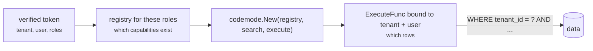

# Roles and tenants

This page builds one request path for a product with many customers (tenants),
many users per tenant, and several roles per user. [Permissions](/permissions)
explains each lock on its own; this page puts them together.

## Three questions, three places

| Question | Example | Answered by | Where |
| --- | --- | --- | --- |
| Which **capabilities exist** for this caller? | a viewer has no `tasks.delete` | roles and permissions | `(codemode.roles)` / `(codemode.permissions)` in protos → `Registry.For` |
| Which **tenant's data** do they reach? | acme never sees globex rows | the tenant | your `ExecuteFunc` |
| Which **rows inside the tenant**? | a member sees their own tasks, a manager their team's | the user and role | your `ExecuteFunc` |

Codemode answers the first. It has no idea what a tenant is, and that is
deliberate: the second and third live where your data does.



## The identity

Your authentication produces it once per request, from a verified session or
token, never from the request body:

```go
type Identity struct {
	Tenant string
	User   string
	Roles  []string // e.g. ["member"], ["member", "billing"]
}
```

It travels on the `context.Context` into `ExecuteFunc`. No proto message has a
field for any of it, so a program has nothing to set.

## Roles: declare them in the contract

```protobuf
service TaskService {
  option (codemode.namespace) = "tasks";

  rpc List(ListRequest) returns (TaskList) {           // everyone
    option (codemode.description) = "Lists tasks you can see.";
  }
  rpc Assign(AssignRequest) returns (Task) {           // either role
    option (codemode.description) = "Moves a task to another person.";
    option (codemode.roles) = "manager admin";
  }
  rpc Delete(DeleteRequest) returns (Empty) {          // one role
    option (codemode.description) = "Deletes a task.";
    option (codemode.roles) = "admin";
  }
}

service BillingService {
  option (codemode.namespace) = "billing";
  option (codemode.default_roles) = "billing admin";   // every method, and every new one

  rpc Invoices(InvoicesRequest) returns (InvoiceList) {
    option (codemode.description) = "Lists invoices.";
  }
  rpc Refund(RefundRequest) returns (RefundResult) {
    option (codemode.description) = "Refunds an invoice.";
    option (codemode.roles) = "admin";                 // replaces the default
  }
}
```

- Several roles on one RPC: separate them with spaces. Any one of them grants it.
- A method that declares `roles` or `permissions` **replaces** both service
  defaults; it does not add to them, and does not inherit the other one.
- No annotation means every role. Pin that set in a test (below).

## Users with several roles

Pass everything the caller holds, fetched per request from your app's session
or database:

```go
allowed := full.For(capability.Caller{Roles: identity.Roles})
```

A user with `["member", "billing"]` gets the unrestricted capabilities, plus
`billing.invoices`, but not `tasks.assign` or `billing.refund`. A user with no
roles still gets the unrestricted ones. Blank, unknown or wrongly cased names
add nothing, so a typo loses access rather than gaining it.

## Tenants: scope every query in `ExecuteFunc`

Bind the identity once per request and scope every query by tenant first, then
by user and role:

```go
func (app *App) Execute(ctx context.Context, rpc string, input json.RawMessage) (json.RawMessage, error) {
	identity, ok := IdentityFrom(ctx)
	if !ok || identity.Tenant == "" {
		return nil, errors.New("no identity on the context") // a wiring bug: stop, never default
	}
	scope := Scope{Tenant: identity.Tenant, Owner: identity.User}
	if slices.Contains(identity.Roles, "manager") || slices.Contains(identity.Roles, "admin") {
		scope.Owner = "" // whole tenant, still one tenant
	}

	switch rpc {
	case "tasks.v1.TaskService/List":
		return app.listTasks(ctx, scope)
	// every case takes scope; none reads a tenant or owner from input
	}
	return nil, fmt.Errorf("unknown rpc %s", rpc)
}
```

Rules that keep this safe:

- **The tenant is never optional.** A missing tenant is an error, not "all
  tenants". The zero value of `Scope` must reach nothing.
- **No proto field names a tenant or owner.** If `ListRequest` had `tenant_id`,
  the program could set it, and the first thing an injected prompt tries is
  another customer's id.
- **Answer "not found", not "forbidden",** for another tenant's id, so a program
  cannot probe which ids exist.
- **Enforce it below the application too** where you can: a Postgres row-level
  security policy on `tenant_id` catches the query somebody forgets to scope.

## Per-tenant policy

Some policy is not in the contract: the plan a tenant pays for, a feature flag,
an admin's choice to lock something down. Apply it per request, after the roles,
with calls that **only narrow**:

```go
// Features the plan does not include disappear entirely.
func forTenant(full capability.Registry, tenant TenantConfig) capability.Registry {
	return full.Select(func(item capability.Capability) bool {
		return !strings.HasPrefix(item.Name, "billing.") || tenant.Plan == "business"
	})
}

// This tenant wants deletes for admins only, even where the proto is wider.
func lockDeletes(allowed capability.Registry, tenant TenantConfig, caller capability.Caller) capability.Registry {
	if !tenant.LockDeletes || slices.Contains(caller.Roles, "admin") {
		return allowed
	}
	return allowed.Select(func(item capability.Capability) bool {
		return !strings.HasSuffix(item.Name, ".delete")
	})
}
```

```go
caller := capability.Caller{Roles: identity.Roles, Permissions: permissions}
allowed := lockDeletes(forTenant(full, tenant).For(caller), tenant, caller)
```

`Select` and `For` only ever remove, so the result is never wider than the
protos. Avoid `Require` for this: on a capability that already has roles or
permissions it *adds* the role as another way in, rather than restricting it.

### Dynamic roles: permissions in the proto, grants in your app

Most CRMs and back-office apps let an admin create roles at runtime ("Senior AE",
"Sales Ops", "Regional Lead") and tick boxes for what each may do. Those role
names live in a database and change without a deploy, so they cannot go in a
`.proto` file.

Split it into three layers instead:

| Layer | Holds | Changes when | Lives in |
| --- | --- | --- | --- |
| **Permissions** | what each RPC requires: `deals.write`, `reports.read` | you add an RPC | the proto, reviewed in code |
| **Roles** | which permissions each role grants | an admin edits a role | your database |
| **Limits** | values a grant carries: max discount, max deal value, own records only | an admin edits a role | your database, enforced in `ExecuteFunc` |

**1. In the proto, name the permission each RPC needs** with
`(codemode.permissions)`, and put `(codemode.default_permissions)` on the service:

```protobuf
service DealService {
  option (codemode.namespace) = "deals";
  option (codemode.default_permissions) = "deals.read";

  rpc List(ListDealsRequest) returns (DealList) {
    option idempotency_level = NO_SIDE_EFFECTS;
    option (codemode.description) = "Lists deals.";
  }
  rpc Move(MoveDealRequest) returns (Deal) {
    option (codemode.description) = "Moves a deal to another stage.";
    option (codemode.permissions) = "deals.write";
  }
  rpc Discount(DiscountRequest) returns (Deal) {
    option (codemode.description) = "Applies a discount to a deal.";
    option (codemode.roles) = "admin";                 // a fixed role
    option (codemode.permissions) = "deals.discounts.write"; // or a runtime one
  }
}

service ReportService {
  option (codemode.namespace) = "reports";
  option (codemode.default_permissions) = "reports.read";

  rpc Pipeline(PipelineRequest) returns (DealList) {
    option idempotency_level = NO_SIDE_EFFECTS;
    option (codemode.description) = "Whole-org pipeline.";
  }
}
```

Put `default_permissions` (or `default_roles`) on every service. A new RPC then
requires the service's permission until someone decides otherwise, instead of
arriving open to every role an admin ever created. `Discount` shows the two kinds
mixed: the fixed `admin` role, or any runtime role granted `deals.discounts.write`.
Discounting is a sub-resource of deals, so `deals.manage` covers it too.

**2. Per request, fetch the user's permissions from your app and pass them in.**
Codemode does not store roles; it filters by whatever list you hand it, so it
always follows your app's current settings.

```go
// Grants is what the admin screen edits: role → permissions, per org.
type Grants interface {
	Permissions(ctx context.Context, org string, roles []string) ([]string, error)
}
```

```go
permissions, err := grants.Permissions(ctx, session.Org, session.Roles)
if err != nil {
	return err // fail closed: no permissions, no assistant
}
allowed := full.For(capability.Caller{Roles: session.Roles, Permissions: permissions})
mode, err := codemode.New(allowed, capability.Keyword(allowed), execute)
```

`Roles` match `(codemode.roles)`, `Permissions` match `(codemode.permissions)`,
and either is enough. `full.Permissions()` lists every permission the protos
define: the checkboxes for your role-editing screen.

If your app is not written in Go, the codemode service asks it over HTTP, with
the user's own token, on every request:

```go
permissions, err := sidecar.Permissions(ctx, crmURL, client) // GET /api/me/permissions as the user
allowed := full.For(capability.Caller{Permissions: permissions})
```

That function is in [A CRM not written in Go](/existing-app#a-crm-not-written-in-go).
Either way, an admin's edit applies on the user's next request, with nothing to
restart, because nothing about the caller is kept between requests.

With these roles in the database:

| Role (created at runtime) | Grants | Capabilities the model gets |
| --- | --- | --- |
| Junior AE | `deals.read` | `deals.list` |
| Senior AE | `deals.read` `deals.write` `deals.discounts.write` | `deals.list` `deals.move` `deals.discount` |
| Sales Ops | `deals.read` `reports.read` | `deals.list` `reports.pipeline` |
| Revoked Intern | (none) | (none) |
| Deal Editor | `deals.write` | `deals.list` `deals.move`: write implies read |
| Deals Admin | `deals.manage` | `deals.list` `deals.move` `deals.discount`: manage is everything on deals |
| fixed role `admin`, no grants | — | `deals.discount` only: a fixed role reaches only RPCs that name it |

`TestDynamicRoleTable` in `capability/permission_test.go` checks this table. Two checks stop a typo
from silently failing closed: `full.ValidatePermissions(submitted)` when an admin
saves a role, and the same test for your own roles. See
[Naming and validation](/permissions#naming-and-validation).

**3. Enforce limits in `ExecuteFunc`.** The registry answers *may this caller
call `deals.discount` at all*. "Up to 15%" or "only deals under $50,000" is a
value from the grant, checked where the data is:

```go
func discount(ctx context.Context, input json.RawMessage) (json.RawMessage, error) {
	grants, _ := ctx.Value(grantsKey{}).(map[string]Grant)
	grant, ok := grants["deals.discounts.write"]
	if !ok {
		return nil, codemode.Permanent(errors.New("not permitted")) // registry and grants disagree: fail closed
	}
	request := &permv1.DiscountRequest{}
	if err := protojson.Unmarshal(input, request); err != nil {
		return nil, err
	}
	if request.GetPercent() > grant.MaxDiscount {
		return nil, codemode.Permanent(fmt.Errorf("discount of %.0f%% is over your limit of %.0f%%",
			request.GetPercent(), grant.MaxDiscount))
	}
	return applyDiscount(ctx, request) // your service layer, as before
}
```

Return limit violations as `codemode.Permanent` so the agent stops instead of
rewriting the program. The message is read by the model, so it can tell the user
what their limit is. If the model should plan around limits up front, say them
in `Instructions` too ("this user can discount up to 15%").

What follows from building the registry per request:

- **Role edits apply on the next request.** Nothing is compiled in. If you cache
  `Permissions` lookups, use a short TTL and drop the entry when an admin saves a
  role.
- **The program cache stays correct.** Its key includes a fingerprint of the
  capability set, so two roles with different permissions never share a cached
  program, and an admin's edit changes the fingerprint. Add limits that appear in
  `Instructions` to `CacheCaller`.
- **The protos cap everything.** A database row can combine permissions the
  protos define; it cannot create one. An RPC with no matching permission in any
  grant is simply unreachable.

### Read-only roles

For a reporting role, drop every write regardless of annotations:

```go
if slices.Contains(roles, "viewer") {
	allowed = allowed.Select(func(item capability.Capability) bool { return item.ReadOnly })
}
```

`ReadOnly` comes from `idempotency_level = NO_SIDE_EFFECTS` on the RPC.

## Capabilities that exist only for one tenant

A tenant that connected their own GitHub gets `github.*` capabilities; others do
not. Import them per tenant with [`mcpsource`](/capabilities#capabilities-from-an-mcp-server),
restricted to a role, and merge them into that tenant's registry:

```go
github, err := mcpsource.Import(ctx, tenant.GitHubSession, "github", "engineer")
registry, err := capability.Merge(forTenant(full, tenant), github.Registry)
```

Route `mcpsource.RPCPrefix("github")` to `github.Execute` and everything else to
your own `ExecuteFunc`. Cache the import per tenant; do not list tools on every
request.

## Search

Build search over the same narrowed registry you give `codemode.New`, so the
model is only told about capabilities it can call.

- **Keyword search:** build it per request from the narrowed registry. It is a
  loop over a slice.
- **One semantic index for everyone:** fine. `codemode`'s `Search` keeps only
  matches in the caller's registry and uses the registry's copy of each, so a
  shared index cannot leak another role's or tenant's capability names into the
  prompt.
- **Tenant-only capabilities in a shared index:** embed them under their
  tenant-prefixed name, or keep a small index per tenant for them.

## Caching programs

A cached program contains code, not data. When it runs again, every call goes
through the *current* caller's `ExecuteFunc`, so acme's cached program run for
globex reads globex's rows. Programs can usually be shared across tenants.

What scopes the cache:

| Key part | Set by | Separates |
| --- | --- | --- |
| Capability fingerprint | automatic, from the registry | callers with different capability sets (roles, plans) |
| `CacheCaller` | you | anything else that shapes the program |

Put in `CacheCaller` whatever reaches the prompt and could end up written into the
program: a role set (sorted), and the tenant or user if your `Instructions`
mention them by name.

```go
sorted := slices.Sorted(slices.Values(roles))
caller := strings.Join(sorted, ",")
if instructionsMentionUser {
	caller += "|" + identity.Tenant + "|" + identity.User
}
```

## Sandbox, fairness and audit

| | Per what | How |
| --- | --- | --- |
| Sandbox | per run | one shared runner; process isolation or a container worker for untrusted tenants ([Running the worker](/worker)) |
| Rate limit | per tenant **and** per user | so one user cannot spend a tenant's quota, and one tenant cannot starve others |
| Concurrency | per tenant | a cap on programs running at once |
| Audit | per call | `OnCall` with tenant, user, roles, capability, input hash |

## The whole request

```go
func (server *Server) ask(writer http.ResponseWriter, request *http.Request) {
	identity, ok := IdentityFrom(request.Context()) // set by auth middleware from a verified token
	if !ok {
		http.Error(writer, "unauthenticated", http.StatusUnauthorized)
		return
	}
	tenant, err := server.tenants.Get(request.Context(), identity.Tenant)
	if err != nil {
		http.Error(writer, "unknown tenant", http.StatusForbidden)
		return
	}
	if !server.limits.Allow(identity.Tenant, identity.User) {
		http.Error(writer, "slow down", http.StatusTooManyRequests)
		return
	}

	// Roles are dynamic (admin-edited); the proto names permissions. See "Dynamic roles".
	permissions, err := server.grants.Permissions(request.Context(), identity.Tenant, identity.Roles)
	if err != nil {
		http.Error(writer, "permissions unavailable", http.StatusServiceUnavailable) // fail closed
		return
	}
	allowed := forTenant(server.full, tenant).For(capability.Caller{Roles: identity.Roles, Permissions: permissions})
	mode, err := codemode.New(allowed, server.search, server.app.Execute)
	if err != nil {
		http.Error(writer, err.Error(), http.StatusInternalServerError)
		return
	}

	ctx, cancel := context.WithTimeout(request.Context(), 2*time.Minute)
	defer cancel()
	result, err := agent.Run(ctx, mode, server.model, request.FormValue("q"), agent.Options{
		Runner:       server.runner, // shared; SANDBOX_ISOLATION decides in-process or worker
		Cache:        server.cache, // keyed by the capability set already; CacheCaller adds anything else in the prompt
		Instructions: "You answer for one user of one organisation. Say so when a request needs data outside it.",
		OnCall: func(call codemode.Call) {
			server.audit(identity, call)
		},
	})
	if err != nil {
		http.Error(writer, err.Error(), http.StatusBadGateway)
		return
	}
	writer.Write([]byte(agent.Answer(result.Answer)))
}
```

`server.app.Execute` reads the identity from `ctx`, so the same `ExecuteFunc`
serves every tenant and still scopes each call.

## Tests worth having

| Test | Catches |
| --- | --- |
| `full.Unrestricted().Names()` equals a pinned list | a new privileged RPC that forgot `(codemode.roles)` or `(codemode.permissions)` |
| for each role, `full.For(capability.Caller{Permissions: grantsOf(role)}).Names()` equals a pinned list | a role quietly gaining a capability |
| a user of tenant A calls every read capability with ids from tenant B → "not found" | a query missing its tenant scope |
| `Execute` with no identity on the context → error | a code path that defaults to "everyone" |
| a program calls a capability its role lacks → `capability "x" is not registered` | the registry being built too wide |
| two tenants, same request, same cached program → each sees only its rows | a cache keyed too loosely, or data in a program |
| a viewer's registry has no capability with `ReadOnly == false` | a write reaching a reporting role |

[`examples/taskreport`](https://github.com/mukezhz/codemode/tree/main/examples/taskreport)
implements users, roles, row scoping, rate limits and audit for one organisation;
add the tenant column and the tests above to take it to many.
