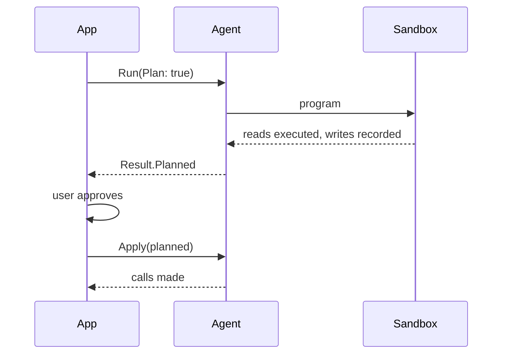

# Writes and retries

A program that fails is sent back to the model to fix. That is safe for a
program that only read; a program that wrote before failing would repeat the
write. Code mode therefore needs to know which RPCs have side effects.

## Marking reads

Mark every RPC that changes nothing with protobuf's own option:

```proto
rpc List(ListTasksRequest) returns (TaskListResponse) {
  option idempotency_level = NO_SIDE_EFFECTS;
  option (codemode.description) = "Lists tasks, newest first.";
}
```

Anything else — no option, or `IDEMPOTENT` — is treated as a write. Forgetting
the option costs a retry, never a duplicate write.

## When a run is not retried

`agent.Run` stops with `agent.ErrNotRetried` instead of asking for a repair when:

- the failed program made a write, even one that itself failed, since it may
  have committed; or
- a capability returned an error wrapped with `codemode.Permanent`, such as a
  permission denial, which no rewrite of the program can fix.

```go
if !allowed {
	return nil, codemode.Permanent(errors.New("permission denied"))
}
```

A cached program that fails after a write is likewise not regenerated.

## What a run did

`Result.Calls` lists every capability call across all attempts, in order, with
input, output, error, and duration. Use it for audit logs and for showing a
user what changed.

## Approving writes first

With `Options.Plan`, reads run but writes are recorded instead of executed and
returned in `Result.Planned`. Show them, then apply exactly those:

```go
result, err := agent.Run(ctx, mode, model, request, agent.Options{Runner: runner, Plan: true})
// ... user approves result.Planned ...
calls, err := agent.Apply(ctx, mode, result.Planned)
```



A planned write returns `{}` to the program, so a program that uses a write's
output — the ID of a task it just created, say — cannot be planned accurately.
`Apply` passes each call through the registry and your transport again, so it
is no more trusted than a direct call.

## Response size

`sandbox.Options.MaxResponseBytes` (default 1 MiB) rejects any single
capability response larger than the limit. It bounds what a program is handed,
not what it allocates. For a hard memory limit, set `SANDBOX_ISOLATION=process`:
`Options.MaxHeapBytes` (default 256 MiB) caps the worker's heap.

## Watching a run

`Options.OnCall` receives each call as it completes — the hook for tracing,
metrics, or a live progress view. Code mode imports no tracing SDK; start your
OpenTelemetry span there, or wrap your `ExecuteFunc` and `llm.Client`.

```go
agent.Options{Runner: runner, OnCall: func(call codemode.Call) {
	log.Printf("%s %s err=%q", call.Name, call.Duration, call.Error)
}}
```

## Token budget

`Result.Usage` reports the tokens the model consumed across every attempt.
`Options.MaxTokens` stops repair attempts once that many are spent, failing
with `agent.ErrTokenBudget`. It is checked between attempts, so one response may
overshoot it. Both shipped providers report usage; a custom `llm.Client` does by
calling `llm.Report(ctx, usage)`, and one that does not is never limited.
