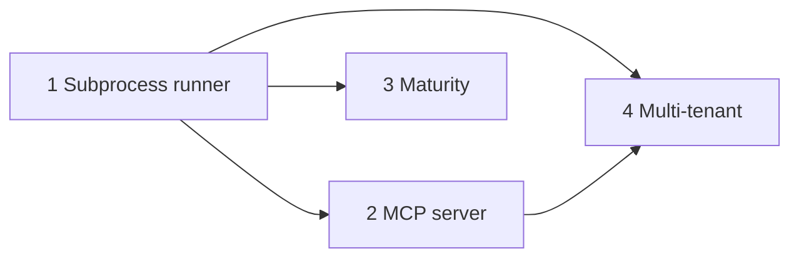

# Hardening: isolation, reach, maturity

Three weaknesses, in order: in-process sandboxes are not a memory or security
boundary; capabilities only come from proto, so nothing outside Go can use
codemode; the project has little external evidence that it holds up. Each phase
ships on its own and is useful without the next.

| Phase | Doc | Size | Trigger |
| --- | --- | --- | --- |
| 1 Subprocess runner | [2026-10-phase1-subprocess-runner.md](2026-10-phase1-subprocess-runner.md) | 2–3 days | now |
| 2 MCP server | [2026-10-phase2-mcp-server.md](2026-10-phase2-mcp-server.md) | 1–2 days | after 1 |
| 3 Maturity | [2026-10-phase3-maturity.md](2026-10-phase3-maturity.md) | ~1 day | alongside 2 |
| 4 Multi-tenant | [2026-10-phase4-multi-tenant.md](2026-10-phase4-multi-tenant.md) | 3–5 days | first external tenant |

## Principles that hold across every phase

- **The host is the only trusted party.** Anything that runs model-written code
  is assumed compromised. Limits that matter (call budget, timeout, response
  size, roles, row scoping) are enforced on the host side of a boundary.
- **Credentials never cross the bridge.** The bridge is `(name, input) → output`.
  Databases, secrets and auth stay in `ExecuteFunc`.
- **New backends are new packages.** No switch cases in parent packages;
  `scripts/check-consumer.sh` stays green.
- **Capability policy stays in protos.** Nothing in this plan adds a Go list of
  privileged names.

## Already in place (do not rebuild)

- `sandbox.Runner` port with registered engines (`sandbox/runner.go`).
- Host-side registry check in `codemode.Execute`; role filtering via
  `Registry.ForRole` / `Require`.
- Per-run call budget, timeout, `MaxResponseBytes` per call (`sandbox.Options`).
- `codemode.Recorder` with `OnCall` hook, exposed as `agent.Options.OnCall`.
- CI already runs gofmt, vet, `go test -race`, buf lint, generated-code diff,
  consumer check, docs build.
