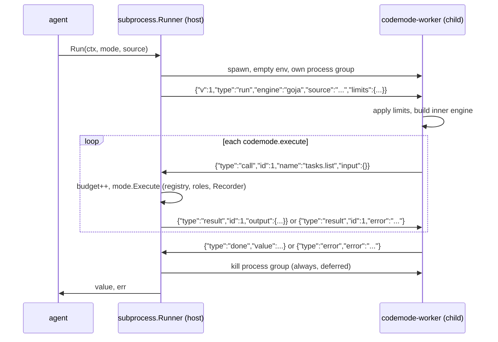

# Phase 1 — Subprocess runner

Parent: [2026-10-hardening.md](2026-10-hardening.md)

## Problem

goja, Starlark and Lua run in the host process. They deny ambient capabilities,
but they share the host's heap and goroutines:

- `let a=[]; while(1) a.push(new Array(1e6))` exhausts host memory long before
  the 30s timeout. The OOM kill takes down every in-flight request.
- Deep recursion or a pathological regex can pin a CPU and starve other requests.
- An interpreter escape (a bug in goja, not in codemode) lands in a process that
  holds the DB pool, API keys and every user's session.

`sandbox.Options.MaxResponseBytes` already carries a `ponytail:` note saying a hard
memory cap needs process isolation. This phase is that.

## Goal

A `sandbox.Runner` that runs the program in a child process, with every limit
the host cares about enforced from outside the child. Programs, prompts and the
model's view are unchanged; the only switch is the engine name.

Non-goal: stopping a determined attacker on macOS. Phase 1 buys availability
everywhere and meaningful isolation on Linux. A real kernel boundary is phase 4.

## Design

### Packages

| Path | Role | Imports vendor? |
| --- | --- | --- |
| `internal/wire` | `Message` type, `Encoder`, size-capped line `Decoder` | no |
| `sandbox/subprocess` | host-side `Runner`; registers `subprocess-goja`, `subprocess-starlark`, `subprocess-lua` | no |
| `cmd/codemode-worker` | child binary; blank-imports the three engines | yes (it is a binary) |

`sandbox/subprocess` must not import an engine package. It resolves the inner
engine through `sandbox.New(Options{Engine: inner})` for `Language()` and
`Prompt()`, so the consumer blank-imports the inner engine exactly as today. If
they forget, the existing "add `_ import`" error fires.

### Why a worker `CodeMode` and not a new bridge

The worker builds a `codemode.CodeMode` whose `Execute` writes a `call` line and
blocks on the matching `result`. It then calls the existing engine's `Run` with
that mode. Engine code does not change at all; the three engines stay the only
interpreters in the repo.

### Wire protocol (v1)

JSON lines, one object per line, stdin host→worker, stdout worker→host. Stderr
is captured (capped at 64 KiB) for diagnostics only and never parsed.

| type | dir | fields |
| --- | --- | --- |
| `run` | H→W | `v`, `engine`, `source`, `limits{timeout_ms,max_calls,max_response_bytes,max_heap_bytes}` |
| `call` | W→H | `id`, `name`, `input` (raw JSON) |
| `result` | H→W | `id`, `output` (raw JSON) or `error` (string) |
| `done` | W→H | `value` (raw JSON, may be `null`) |
| `error` | W→H | `error` (string) |

Rules:
- Calls are strictly sequential (engines are synchronous). Host rejects a `call`
  while one is outstanding, and a `result`/`done` with a wrong `id`.
- Unknown `type`, bad JSON, or a line over the cap → host kills the worker and
  returns `worker protocol error: ...`. Never retried.
- `v` mismatch → worker replies `error`, host returns it. Lets host and worker
  binaries drift detectably.
- `done.value` is JSON. Engines already return JSON-shaped values
  (`goja.Value.Export`, Starlark/Lua converters). A value that fails to marshal is
  an `error`, not a crash.

### Limits and where they live

| Limit | Enforced by | Mechanism |
| --- | --- | --- |
| Call budget | host | counter per `call` line; over → kill, `call budget of N exhausted` (same text as engines) |
| Per-call response size | host | `Options.CheckResponse` before writing `result` |
| Final value / any line size | host | `bufio.Reader` line cap = `MaxResponseBytes + 4 KiB` |
| Wall clock | host | `exec.CommandContext` with `ctx` timeout; `cmd.Cancel` kills the group; `cmd.WaitDelay` 1s |
| Env | host | `cmd.Env = []string{}`; `cmd.Dir` = empty temp dir |
| Orphans | host | `SysProcAttr.Setpgid`; kill `-pgid`; Linux also `Pdeathsig: SIGKILL` |
| Heap | worker | `debug.SetMemoryLimit` + watchdog goroutine reading `runtime/metrics` `/memory/classes/heap/objects:bytes` every 10ms; over cap → `os.Exit(3)` |
| Address space, CPU, fds | worker, Linux | `setrlimit` RLIMIT_AS, RLIMIT_CPU, RLIMIT_NOFILE before reading `run` |
| Network, filesystem view | host, Linux | `Cloneflags: CLONE_NEWUSER\|CLONE_NEWNET\|CLONE_NEWNS` plus uid/gid maps |

Worker-side limits are cooperative: they stop runaway programs, not an attacker
who escaped the interpreter. That is acceptable here and stated in `SECURITY.md`
(phase 3). macOS ignores RLIMIT_AS, which is why the heap watchdog exists and why
it is the portable limit.

Worker exit code 3 → host reports `sandbox: memory limit of N bytes exceeded`.
Any other unexpected exit → `worker exited: <status>: <stderr tail>`.

### Configuration

`sandbox.Options` gains two fields, both read in `sandbox/env.go` only:

| Field | Env | Default |
| --- | --- | --- |
| `Worker []string` | `SANDBOX_WORKER` (split on spaces) | `exec.LookPath("codemode-worker")` |
| `MaxHeapBytes int` | `SANDBOX_MAX_HEAP_BYTES` | 256 MiB |

`MaxHeapBytes` is ignored by in-process engines; document that in `Name()`.

### What stays the same

- `agent` code: untouched. `Recorder`, `OnCall`, idempotency and usage budgets
  all work because `mode.Execute` still runs in the host with the same `ctx`.
- Program cache fingerprint: from `mode`, unaffected by runner.
- Prompts: `Language()` and `Prompt()` delegate to the inner runner, so the model
  sees exactly what it sees today.

## Milestones

### M1.1 Wire package

- `internal/wire/wire.go`: `Message` struct, `NewEncoder(io.Writer)`,
  `NewDecoder(io.Reader, maxLine int)`; `Decode` returns `ErrLineTooLong`.
- Tests: round trip each type; oversized line; truncated line at EOF; non-JSON.
- `FuzzDecode` (seeds from the tests). Lands here, run in CI in phase 3.

Done when: `go test ./internal/wire` green; fuzz runs 30s clean locally.

### M1.2 Worker binary

- `cmd/codemode-worker/main.go`: read `run`, check `v`, apply limits, build inner
  runner via `sandbox.New`, run with the wire-backed `CodeMode`, write `done`/`error`.
- `limits_linux.go` / `limits_other.go`: rlimits on Linux, no-op elsewhere.
- Heap watchdog in `main.go` (portable).
- Worker ignores its environment entirely; everything comes from `run`.

Done when: `echo '{"v":1,"type":"run","engine":"goja","source":"return 1+1"}' | codemode-worker`
prints `{"type":"done","value":2}`.

### M1.3 Host runner

- `sandbox/subprocess/subprocess.go`: `Runner`, `New`, `init` registration of the
  three `subprocess-*` names. `var _ sandbox.Runner = (*Runner)(nil)`.
- `proc_linux.go` / `proc_other.go`: `SysProcAttr` (pgid always; namespaces and
  Pdeathsig on Linux).
- Add to `shipped` map? No: `shipped` names engine packages; the error from the
  inner `sandbox.New` already names the missing import.
- Add `sandbox/subprocess` to the `CGO_ENABLED=0` build list in
  `scripts/check-consumer.sh`.
- `Name()`: `subprocess(goja) / JavaScript (30s timeout, 50 call budget, 256 MiB heap)`.

Done when: `make test` green; `make demo-todo` works with
`SANDBOX_ENGINE=subprocess-goja SANDBOX_WORKER=./bin/codemode-worker`.

### M1.4 Escape and failure tests

Extend `sandbox/enginetest/engines_test.go`: `engines()` gains the three
`subprocess-*` variants, built once via `go build` into `t.TempDir()` in
`TestMain`. Every existing test then runs against them for free.

New table fields and tests, run against all six runners:

| Test | Program | Expect |
| --- | --- | --- |
| `TestEnginesSurviveMemoryBomb` | grow arrays forever | error; host heap delta < 64 MiB. In-process engines: `t.Skip` with reason (documents the gap) |
| `TestEnginesStopDeepRecursion` | unbounded recursion | error, no host crash |
| `TestEnginesRejectHugeResult` | return 10 MiB string | size error |
| `TestEnginesRejectForbiddenCapability` | call name not in registry | existing registry error text |

Subprocess-only tests in `sandbox/subprocess`:

- fake worker (test binary re-exec via `os.Args[0]` + env flag) that sends
  garbage, sends a call with wrong id, sends two calls without waiting, exits
  mid-call, sleeps forever. Each → specific error, returns within timeout + 1s,
  no leaked process (`kill -0 pid` fails after `Run`).
- env is empty: fake worker echoes `os.Environ()` length.
- ctx cancel mid-call kills the worker.

Done when: all green under `-race`; `go test -count=20 ./sandbox/subprocess` shows
no flake.

### M1.5 Docs and build

- `make worker` target building `bin/codemode-worker`; `make test` depends on it
  if the enginetest `TestMain` does not build it itself (prefer the latter).
- `docs/content/sandbox.md`: move the isolation ladder rung to "shipped", add
  configuration table. No new page; sidebar unchanged.
- ADR `notes/decisions/0005-subprocess-runner.md`: why JSON lines over gRPC
  (no codegen, debuggable with `echo`), why host-side limits, why per-run process
  over a pool.

## Risks

| Risk | Mitigation |
| --- | --- |
| Spawn latency (~5–20ms per run) | Measure in `agent` Timing. Program cache already skips repeats. Pool only if measured. |
| Worker/host version drift | `v` field; worker built from same module. |
| User namespaces disabled on some Linux hosts (e.g. hardened kernels, some CI) | Detect `EPERM` on start, fall back to no namespaces with a one-time log line; test both. |
| Heap watchdog misses a fast spike | RLIMIT_AS backstop on Linux; on macOS accept, documented. |
| Engine returns non-JSON value (e.g. Starlark set) | Marshal error → clean `error`; add case to enginetest. |

## Out of scope

seccomp/Landlock, containers, warm pool, Windows support (worker builds, namespaces
and pgid code are behind build tags; Windows gets timeout + env only).
