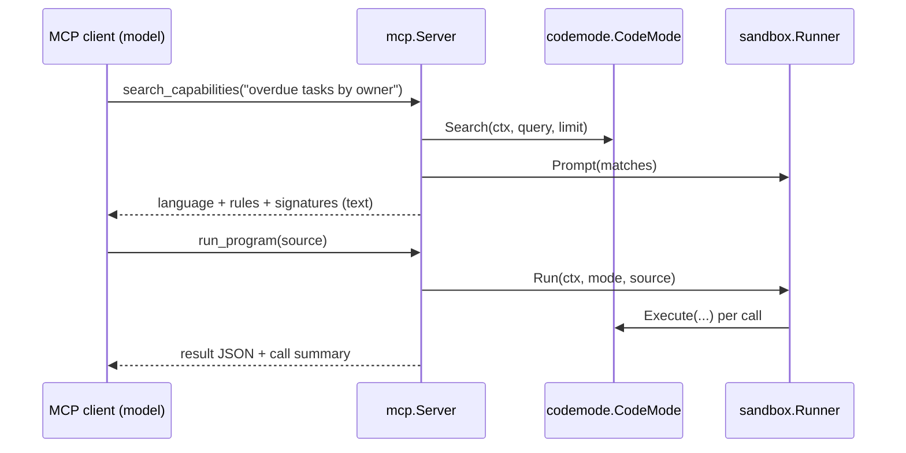

# Phase 2 — MCP server

Parent: [2026-10-hardening.md](2026-10-hardening.md) · Depends on: phase 1

## Problem

Only Go programs that link codemode can use it. MCP clients (Claude Desktop,
Claude Code, Cursor, Docker Agent) already own conversation, delegation and
distribution. Competing with them is pointless; plugging into them is cheap.

## Goal

Any MCP client can discover a host's capabilities and run a program against them,
with the same registry, roles, budgets and sandbox the Go API uses.

Non-goals: HTTP/SSE transport, OAuth, codemode calling an LLM on the client's
behalf.

## Key decision: the client's model writes the program

Two shapes were possible:

| Shape | Tool | Who writes code |
| --- | --- | --- |
| A | `ask(question)` → server runs `agent.Run` with its own LLM | server's LLM |
| B | `search_capabilities` + `run_program(source)` | client's LLM |

Pick **B**. The client already has a capable model; a second model adds latency,
cost and a second set of API keys. B also needs no `llm` import, so the MCP
package stays small. A can be added later as a third tool if a client without a
strong model needs it.

## Design

### Tools

`search_capabilities`
- input: `{ query: string, limit?: int (default 8, max 25) }`
- output: text content = `runner.Prompt(matches)`. That string is already the
  exact thing codemode gives its own model: language rules, example, type shapes,
  signatures. Reusing it means MCP clients write programs the same way.

`run_program`
- input: `{ source: string }` (max 64 KiB)
- output: structured `{ value, calls: [{name, ok, ms}] }` plus a text rendering.
  Errors return `isError: true` with the sandbox/registry error text, so the
  client model can fix and retry.
- Uses `codemode.Recorder` to fill `calls`.

Tool descriptions state the language (`runner.Language()`) so the client model
calls search first.

### Packages

| Path | Role |
| --- | --- |
| `mcpserver/` | `New(mode codemode.CodeMode, runner sandbox.Runner, opts Options) (*mcp.Server, error)`; caller runs it on a transport |
| `examples/todo/cmd/todo-mcp` | wires the todo example's mode + runner to stdio |
| `examples/taskreport/cmd/taskreport-mcp` | same for taskreport, role from flag |

There is no generic `cmd/codemode-mcp`: the server needs the host's
`ExecuteFunc`, which only the host has. The library is the product; examples show
the wiring.

Dependency: `github.com/modelcontextprotocol/go-sdk`, imported only by `mcp/`.
`scripts/check-consumer.sh` unchanged and must stay green (root import does not
reach `mcp/`).

### Security

- **Role is fixed at server construction**, from host config. The client never
  supplies a role; there is no tool argument for it.
- Default runner in examples is `subprocess-goja` (phase 1). The doc says so:
  an MCP client is a program author you do not control.
- Budgets come from `sandbox.Options`; MCP adds `MaxSourceBytes` only.
- stdio transport inherits the launching user; no network listener exists.

## Milestones

### M2.1 Spike the SDK

- Confirm `go-sdk` version, tool registration API, structured output support,
  and that it builds with `CGO_ENABLED=0`.
- Write findings in the ADR (M2.5). Half a day max; if the SDK is unsuitable,
  stdio JSON-RPC by hand is ~200 lines and is the fallback.

### M2.2 `mcp` package

- `mcp/server.go`: tool registration, input validation (limit range, source size),
  error mapping (sandbox error → `isError` content, not a protocol error).
- `var _` assertions not applicable (no port); keep package surface to
  `NewServer`, `Options`, `Serve`.

Tests (`mcp/server_test.go`, in-memory transport from the SDK):
- search returns prompt text containing a known signature.
- run_program success returns value and call list.
- run_program with forbidden capability → `isError`, registry message.
- oversize source rejected before reaching the runner.
- runner timeout surfaces as `isError`.

### M2.3 Example binaries

- `examples/todo/cmd/todo-mcp/main.go`, `examples/taskreport/cmd/taskreport-mcp/main.go`.
- Makefile: `make mcp-todo` runs the todo server on stdio.
- Manual check: register in Claude Code (`claude mcp add todo -- make -s mcp-todo`)
  and complete a todo through it.

### M2.4 Docs

- New page `docs/content/mcp.md` + sidebar entry in `docs/.vitepress/config.ts`:
  what the two tools are, client config snippets (Claude Code, Claude Desktop,
  Cursor), the role/runner security note.

### M2.5 ADR

`notes/decisions/0006-mcp-server-shape.md`: shape B over A, no generic binary,
SDK choice.

Done when: `make test` green; a real MCP client completes a todo end to end via
`subprocess-goja`.

## Risks

| Risk | Mitigation |
| --- | --- |
| SDK API churn (pre-1.0) | Pin version; surface is two tools, cheap to adapt. |
| Client models skip search and guess names | Tool description says to search first; registry error lists nothing, so guessing fails fast and visibly. |
| Large results flood client context | `MaxResponseBytes` already bounds it; document recommended value for MCP (64 KiB). |
