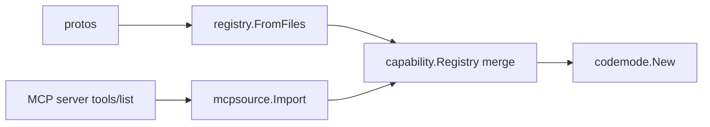

# Phase 4 — Multi-tenant

Parent: [2026-10-hardening.md](2026-10-hardening.md) · Depends on: phases 1, 2 ·
Trigger: first tenant whose users you do not trust

## Problem

Phase 1 stops runaway programs and, on Linux, hides network and filesystem. It
does not survive a kernel exploit or an interpreter escape followed by
privilege escalation. With many tenants, one tenant's program must not be able
to read another's data or degrade their latency.

## Goal

Programs from untrusted tenants run behind a real kernel boundary, with
per-tenant fairness and an audit trail, and MCP servers can be imported as
capability sources without widening anyone's permissions.

## Milestones

### M4.1 Container runner

Same worker, same protocol. `Options.Worker` becomes:

```sh
docker run -i --rm \
  --network none --read-only --tmpfs /tmp:size=8m \
  --cap-drop ALL --security-opt no-new-privileges \
  --user 65534:65534 \
  --memory 256m --memory-swap 256m --cpus 0.5 --pids-limit 32 \
  --runtime runsc \
  ghcr.io/mukezhz/codemode-worker:v0.x.y
```

- `deploy/worker.Dockerfile`: `FROM scratch`, static `codemode-worker`, nothing else.
- Release workflow (phase 3) also pushes the image, signed with cosign.
- Host's Linux namespace code is skipped when the worker argv starts a
  container runtime (the container provides it); detect via an explicit
  `Options.WorkerIsolated bool`, not argv sniffing.
- Test: `make test-container` (needs Docker + gVisor), runs the enginetest escape
  suite against `subprocess-goja` with the docker argv.

Likely zero changes to `sandbox/subprocess` beyond the flag.

### M4.2 Warm pool

Only if M4.1 latency (container start ~150–400ms with gVisor) shows up in
`agent` Timing as a problem.

- `sandbox/subprocess` gains `Pool{Size int}`: pre-starts N workers blocked on
  reading `run`. Each worker serves **one** run then is killed; pool refills
  asynchronously.
- Never reuse a worker: reuse turns a single escape into cross-request leakage.
- Pool per (engine, image) pair; shut down in `Runner.Close()`.
- Test: concurrency test with `-race`; pool drains and refills; Close kills all.

### M4.3 Worker syscall filter (Linux)

Defense in depth inside the container or for subprocess-on-Linux without one.

- After reading `run` and before executing source: Landlock (deny all fs) and a
  seccomp allowlist: `read`, `write` on fds 0–2, `mmap`/`munmap`/`madvise`/`brk`,
  `futex`, `clock_gettime`, `exit_group`, `rt_sigreturn`, `sched_yield`, and what
  the Go runtime needs (`sigaltstack`, `rt_sigprocmask`, `gettid`, `tgkill`).
- Library: `github.com/elastic/go-seccomp-bpf` or `golang.org/x/sys/unix` with a
  hand-built BPF program; decide in an ADR. Linked only by `cmd/codemode-worker`.
- Test: worker program that attempts `open` via a test-only hook → killed with
  SIGSYS; host reports it.

### M4.4 Per-tenant fairness and audit

Host-side, all built on existing hooks; no new port.

- **Rate limit:** `golang.org/x/time/rate` keyed by tenant/user in the host's
  request handler, before `agent.Run`. Lives in example hosts and docs, not in
  the library: the library does not know what a tenant is.
- **Concurrency cap per tenant:** semaphore around `Runner.Run` in the host.
- **Audit log:** `agent.Options.OnCall` writes `{tenant, user, capability, input
  hash, ok, ms}` to an append-only sink. Doc page shows the pattern; taskreport
  example implements it to SQLite.
- **Read-only reporting registries:** example uses `Registry.Select` on the
  capability effect to drop writes for reporting roles; documented in
  `permissions.md`.
- **Result shape check:** before rendering, validate final value against the
  shape the UI expects (taskreport example); doc note in `writes.md`.

### M4.5 MCP servers as a capability source



- New package `capability/mcpsource` (imports MCP SDK; parent `capability` does not).
- `Import(ctx, client, prefix string, role string) (capability.Registry, codemode.ExecuteFunc, error)`:
  - each MCP tool → `Capability{Name: prefix+"."+tool}` with input/output
    JSON Schema converted to `capability.TypeSchema` (unsupported constructs →
    tool skipped with a warning, never loosened to `any`).
  - every imported capability gets `role` via `Require` — MCP tools carry no role
    annotations, so they arrive restricted. Empty role is an error, not "unrestricted".
  - effect defaults to write (unknown = unsafe), so idempotency/write tracking
    treats them conservatively.
  - returned `ExecuteFunc` forwards to the MCP client; host composes it with its
    own via a name-prefix router (helper `codemode.Route(map[prefix]ExecuteFunc)`).
- Registry merge: `capability.Merge(a, b)` fails on duplicate names.
- Tests: fake MCP server (SDK in-memory transport), schema conversion table
  tests, role always applied, duplicate-name error, unsupported-schema skip.
- Docs: section in `capabilities.md`.

### M4.6 Other capability sources (only on demand)

OpenAPI or gRPC reflection importers follow the M4.5 pattern (own package,
restricted by default, fail on duplicates). Do not start without a concrete API
to import.

## Done when

- Escape suite green against the container runner with gVisor.
- Taskreport example runs multi-tenant with rate limit, audit log and
  read-only reporting role.
- An MCP server's tools are callable from a program alongside proto
  capabilities, and are invisible to roles that were not granted.

## Risks

| Risk | Mitigation |
| --- | --- |
| gVisor not available on target platform (e.g. some managed k8s) | Fall back to Kata or Firecracker via a different argv; protocol unchanged. |
| Container start latency | M4.2 pool; program cache already skips sandbox for repeats. |
| seccomp allowlist breaks on Go upgrade | CI runs worker under the filter; Go bumps are their own PR. |
| JSON Schema → TypeSchema is lossy | Skip unsupported tools rather than widening; log what was skipped. |
| Imported MCP tool is itself malicious or compromised | It runs in its own process behind the MCP client; codemode only forwards. Role gate limits who can call it. |
