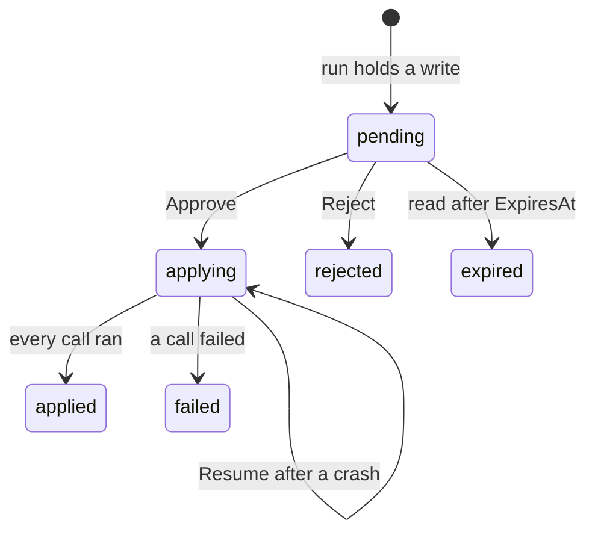

# Durable plans, events and traceable errors

Depends on: [pluggable sources](2026-11-pluggable-sources.md) · Decision:
[0009](../decisions/0009-durable-plans.md)

## Problem

A write that needs approval is held in a plan, but the plan only lives as long
as the response that carried its ID:

- the memory store loses it on restart, and a second replica never sees it;
- the client cannot list what is waiting, so a refresh loses it;
- expiry is fifteen minutes and the client is never told; it learns from a 404;
- there is no status or history: a plan is either there or silently gone;
- a crash halfway through applying loses the plan after some writes ran.

And when a run fails, nothing ties the error, the logs and the plan together.

## Goal

A person can decide tomorrow, on another device, against another replica, and
the developer can see every step a run and its plan took.

```go
plans := agent.NewPlans(store, agent.PlanOptions{TTL: 24 * time.Hour, OnEvent: events})

_, err := agent.Run(ctx, mode, model, request, agent.Options{
	Runner: runner, Plans: plans, PlanOwner: user.ID, OnEvent: events,
})
var pending *agent.Pending          // pending.ID, pending.Calls, pending.ExpiresAt
var failed *agent.Error             // failed.RunID, failed.Stage

inbox, _ := plans.List(ctx, user.ID, agent.PlanPending)
plan, err := plans.Approve(ctx, mode, user.ID, id)
plan, err := plans.Reject(ctx, user.ID, id, "not now")
```

## Design

One object, `agent.Plans`, is the whole approval API. The storage behind it is a
four-method port, so a database adapter stays small:

```go
type PlanStore interface {
	Create(ctx, Plan) error
	Get(ctx, owner, id string) (Plan, error)
	List(ctx, owner string, status PlanStatus) ([]Plan, error)
	Update(ctx, *Plan) error // only if the stored version is plan.Version; then bumps it
}
```

A plan is a row, not a process. No actor and no workflow engine: the database
serialises decisions with a compare-and-set on `version`, so two clicks or two
replicas cannot both apply a plan.



- **Expiry** is checked when a plan is read (`Get`, `List`, `Approve`), and the
  plan is moved to `expired` with an event. No sweeper goroutine.
- **History** records every move with its time, who made it and a note.
- **Apply** records each call's result before the next one runs, so `Resume`
  continues from the first call without a result after a crash.
- **Errors** name the plan and its state:
  `plan 3f2a9c1e is already applied (by ada at 2026-11-16T14:02:00Z)`, wrapping
  `ErrPlanDecided`; a failed call is `plan 3f2a9c1e: call 2 of 3 (tasks.delete): …`.

`agent/sqlplans` implements the port on `database/sql` for SQLite and Postgres,
with the standard library only; the host opens the database with its own driver.

### Events and errors

`Options.OnEvent` and `PlanOptions.OnEvent` receive one `agent.Event` per step:
`run.started`, `search.done`, `program.written`, `program.failed`, `call.done`,
`call.held`, `run.finished`, `run.failed`, and `plan.held`, `plan.applying`,
`plan.applied`, `plan.failed`, `plan.rejected`, `plan.expired`. Each carries the
run ID and, where there is one, the plan ID. `agent.LogEvents(logger)` sends them
to `log/slog`. Tracing and metrics are the host's adapter over the same callback,
so the core links no telemetry SDK.

Every error `agent.Run` returns, except `*Pending`, is an `*agent.Error` with the
run ID and the stage it failed in (`cache`, `search`, `generate`, `run`):
`run 7c1e40a2b9d3f051: generate: …`. The plan records the run ID too, so a
plan, its run, its events and its error share one key.

## Tasks

1. `agent`: `Plan`, `PlanStatus`, transitions, `Plans` (`Get`, `List`, `Approve`,
   `Reject`, `Resume`), `NewMemoryPlanStore`, `Pending` embedding `Plan`.
   Replaces `NewMemoryPlans` and `ApplyPlan` (unreleased).
2. `agent`: `Event`, `Options.OnEvent`, `LogEvents`, `Error`, `Result.RunID`.
3. `agent/plantest.Run`: the contract every `PlanStore` passes.
4. `agent/sqlplans`: SQLite and Postgres on `database/sql`.
5. Examples: shop and taskreport on `Plans`; taskreport keeps plans in its own
   SQLite file, lists them at `GET /api/plans`, and shows an inbox with expiry
   and each plan's history.
6. Docs: approval rewritten around `Plans`, a new observability page, changelog.

## Out of scope

Approvers other than the owner (a manager approving a refund); an OpenTelemetry
adapter package; notifications beyond the `plan.held` event; mocked outputs for
held writes.

## Done when

A plan survives a restart, lists in an inbox with its expiry, applies once
across replicas, resumes after a crash, and every run's error and events carry
the same run ID.
