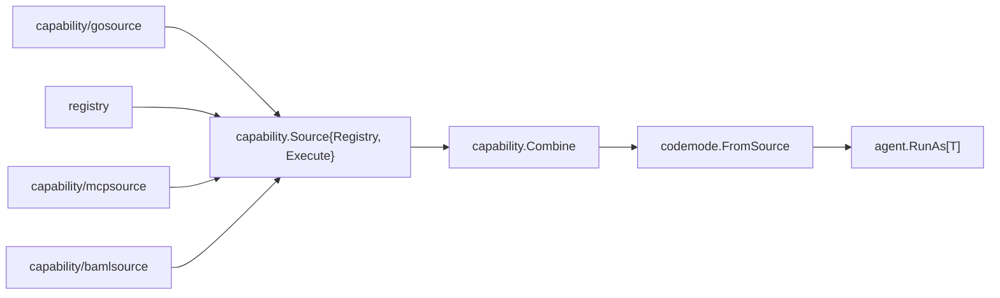

# Pluggable capability sources

Depends on: nothing · Trigger: hosts that do not want protobuf, and every host
that writes a `switch rpc` · Decision: [0008](../decisions/0008-capability-sources.md)

**Status (2026-11-16):** v0.1 implemented, untagged. Differences from the plan
below: `Source`, `Combine` and `FromSource` live in `codemode` (an `ExecuteFunc`
in `capability` would import `codemode`), `sourcetest` is `codemode/sourcetest`,
the Go schema is `capability.SchemaOf` (stdlib reflection, so Go type names reach
the prompt, rather than `jsonschema-go`), and descriptions use a `desc` tag.
T3.5 is done: taskreport serves typed Go functions by default and approves
deletes in the chat. Not done: tagging `v0.1.0`. Open questions
1–3 resolved as: add `Required`, add `integer`, RPC is the capability name;
4 kept as written.

## Problem

From an application developer's side, a first integration asks four things, in
this order:

1. Can I use the Go functions I already have, in ten minutes?
2. Can the model do damage?
3. Can it ask before it deletes something?
4. Can I get a struct back instead of a string?

Today the answer to 1 is no. Protobuf reads as the core, so a first integration
means buf config, a vendored `codemode.proto`, then a `switch rpc` with
hand-typed RPC strings, request structs duplicating the schema, and hand-written
decoding (`examples/todo/app/app.go:54`). Nothing validates a program's
arguments before the handler, approval is all-or-nothing (`Options.Plan`), and
the final answer is `any`.

Protobuf is not the core. `capability`, `codemode`, `agent`, `llm`, `sandbox`
and `program` import neither protobuf nor `registry/`; they work in
`capability.Registry`, `TypeSchema` and `ExecuteFunc`, and `capability/mcpsource`
is already a second source. What is missing is the developer-facing layer.

BAML's appeal is Schema-Aligned Parsing: an LLM result is your type or an error.
The guarantee half applies here. The JSON-repair half does not: program values
leave the interpreter as exact JSON.

## Goal

What a developer writes:

```go
src, err := gosource.New(
	gosource.Func("todos.list", "List todos", gosource.Public(), app.List, gosource.ReadOnly()),
	gosource.Func("todos.delete", "Delete a todo", gosource.Roles("member"), app.Delete, gosource.NeedsApproval()),
)
mode, err := codemode.FromSource(src, caller)

summary, err := agent.RunAs[Summary](ctx, mode, model, "clean up done todos", options)
var pending *agent.Pending
if errors.As(err, &pending) {
	// show pending.Calls; on approval:
	calls, err := agent.ApplyPlan(ctx, mode, plans, pending.ID)
}
```

No buf, no vendored proto, no `switch`, no duplicated struct. Protobuf, MCP and
BAML become other ways to produce the same `capability.Source`.



## The provider contract

Every capability, from any source, carries six things:

| Field | Decided by |
| --- | --- |
| Name, description | provider |
| Input and output schema | provider |
| Handler | provider |
| Effect (read or write) | provider proposes, host decides |
| Access (roles, permissions) | host only |
| Needs approval | host only |

A provider describes; only the host grants. A remote provider can never make its
own tool public, read-only or approval-free.

| Provider | How it provides | Status |
| --- | --- | --- |
| The host's own Go code | `gosource.Func`, or proto `registry.Source(impl)` | v0.1, v0.2 |
| Another team or language | An MCP server in any SDK, imported with `mcpsource` | works; per-caller identity in v0.2 |
| A third-party SaaS | Its MCP server, same path | works |

MCP is the out-of-process path. No new wire protocol.

## Principles

- Every source is its own package. `capability` never imports a vendor SDK;
  `check-consumer.sh` stays green after every task.
- No source may produce an unrestricted capability by omission. Access is a
  required argument wherever the host binds a capability.
- Effect defaults to write. Only an explicit marker makes a capability
  read-only.
- Existing proto users do not break: `registry/` keeps its import path.

## v0.1 — your Go functions, typed, safe, with approval

Four PRs, in order. Tag `v0.1.0` after the last.

### PR 1 — Core contracts

- **T1.1** ADR `0008-capability-sources.md`: the core is source-agnostic,
  sources are adapters, validation and typed results live in the core. Records
  why BAML is a source and not the core, and why SAP's repair half is skipped.
- **T1.2** Move `Source{Registry, Execute, Skipped}` from `mcpsource` to
  `capability`; `mcpsource.Import` returns it. mcpsource tests pass unchanged
  apart from the type name.
- **T1.3** `capability.Combine(sources...) (Source, error)`: merges with the
  existing `Merge` (duplicate names fail) and routes `Execute` by RPC to the
  owning source. Tests: routing, duplicate name, unknown RPC.
- **T1.4** Extract `object`/`fields`/`typeOf` from `mcpsource` into exported
  `capability/jsonschema`. Unsupported constructs stay an error, never `any`.
  Converter tests move with it.
- **T1.5** `capability.Validate(item, input) error` against `item.Input` and
  `item.Types`: unknown fields, JSON kinds, enum values, `repeated`,
  `map<k, v>`, nested types, oneof exclusivity. Errors name the path
  (`items[2].id: want number`). Table tests per rule; a fuzz test that it never
  panics.
- **T1.6** `codemode` runs `Validate` before `execute`. Tests: an invalid call
  never reaches `ExecuteFunc`; the agent's repair prompt carries the path.
- **T1.7** `capability/sourcetest.Run(t, source)`: shared contract every adapter
  calls — unique names, referenced types resolvable, RPC routable, unknown RPC
  errors.

### PR 2 — `capability/gosource`

- **T2.1** `Func[In, Out any](name, description string, access Access,
  handler func(context.Context, In) (Out, error), options ...Option)`.
  `Access` has an unexported method; only `Public()`, `Roles(...)` and
  `Permissions(...)` build one, so there is no zero value to forget.
  Options: `ReadOnly()`, `NeedsApproval()`.
- **T2.2** Schema from `In`/`Out` through `github.com/google/jsonschema-go`
  `For[T]` (already an indirect dependency) and the T1.4 converter.
  Descriptions from its `jsonschema:"..."` tag; no tag of our own.
- **T2.3** `New(funcs...) (capability.Source, error)`: name pattern, duplicates,
  `Execute` decodes into `In` with `DisallowUnknownFields` and encodes `Out`; a
  handler panic becomes an error. Tests: round trip, unknown field rejected,
  `sourcetest.Run`.
- **T2.4** `codemode.FromSource(source, caller) (CodeMode, error)`: applies
  `Registry.For(caller)` and defaults search to `capability.Keyword`.
- **T2.5** `examples/todo` gains a gosource variant beside the proto one. Both
  run the same fixed program and must give the same answer.

### PR 3 — Approval

- **T3.1** `Capability.NeedsApproval bool`. Sources set it: `gosource` through
  `NeedsApproval()`, proto through a new `(codemode.needs_approval)` method
  option, `mcpsource` through an import option (host policy).
  A read-only capability that needs approval is a build error.
- **T3.2** A run holds a write that needs approval, and every write after it,
  instead of executing them. Writes before it execute as today. `agent.Run`
  returns `*agent.Pending{ID, Calls}`. `Options.Plan` stays and still holds
  every write.
- **T3.3** `agent.PlanStore` port (`Save`, `Take` — take deletes, so a plan
  applies once) with an in-memory adapter and a TTL. `agent.ApplyPlan(ctx,
  mode, store, id)` applies by ID, so the client never sends the calls back.
  Calls pass through `Validate`, the registry and access checks again.
- **T3.4** Tests: approval-free writes execute and later ones are held; apply by
  ID once; second apply fails; expired plan fails; a caller who lost access
  fails at apply.
- **T3.5** Taskreport: delete RPCs need approval; the UI shows pending calls
  with approve and reject.

### PR 4 — Typed result

- **T4.1** `agent.RunAs[T any](ctx, mode, model, request, options) (T, Result,
  error)`, a wrapper over `Run`, not a second loop. Schema of `T` through the
  T2.2 path.
- **T4.2** Each dialect's `Runner.Prompt` renders the expected return shape when
  given one (JS, Starlark, Lua). Prompt snapshot test per engine.
- **T4.3** The program's return value is validated against `T`'s schema; a
  mismatch goes through `repairPrompt` with the path error and counts against
  `Attempts`. Tests: wrong shape repairs then succeeds; exhausted attempts
  return the last validation error.

### v0.1 docs

- README leads with the Goal snippet. Protobuf, MCP and BAML move under "Other
  sources".
- `docs/content/sources.md` (choosing a source, the provider contract),
  `docs/content/approval.md`; `writes.md` links to approval; sidebar in
  `docs/.vitepress/config.ts`.
- Quickstart rewritten around `gosource`; the proto quickstart becomes
  `docs/content/protobuf.md`.
- `CHANGELOG.md` `[Unreleased]` per PR.

## v0.2 — other sources, remote safety

- **Proto typed dispatch.** `registry.Source(impl any, files...)`: finds
  `impl.<Method>(context.Context, *Req) (*Resp, error)` by reflection (the gRPC
  server shape), decodes with `protojson`, encodes with `registry.MarshalJSON`.
  A method with no Go implementation fails at build. Removes the switch for
  existing proto users.
- **Per-caller identity in `mcpsource`.** Today one session is bound at import,
  so a remote provider sees one identity for every user and cannot do row-level
  checks. Build the session per call from the caller, like `mcpserver`'s
  `ModeFunc`. Required before multi-user remote providers.
- **Approval over MCP.** `run_program` returns held writes and a plan ID; a new
  `apply_plan` tool applies it. Today an MCP client's user approves program
  text, not the writes it makes.
- **BAML spike**, written up as ADR 0009: does the generated Go types package
  pull cgo or the Rust runtime (`go list -deps`), and does `@description`
  reach the Go output? If the types are plain Go, BAML support is a docs page
  showing them with `gosource`. Only if not, `capability/bamlsource` parses the
  `.baml` subset needed (`class`, `enum`, `@description`, `@alias`, optional,
  lists, maps). Access is a bind-time argument, never a BAML comment.

## Out of scope

SAP JSON repair; JSON Schema files as a source (until a non-Go host asks); OpenAPI
import; Connect handler shape; mocked outputs for planned writes — a program
that uses a held write's output stays unplannable, documented in `approval.md`;
asking the user a question mid-program; moving `registry/`; a `codemode init`
scaffold.

## Open questions

1. `TypeSchema` has `Optional` but no required. Proto3 fields are implicitly
   optional; Go structs and JSON Schema can mean required. Add
   `Required []string`, honoured only by sources that set it?
2. All numerics are `"number"`, so `Validate` cannot reject `1.5` for an `int`.
   Add an `integer` kind?
3. `gosource` RPC string: the capability name, or a separate value?
4. Holding every write after the first approval-required one keeps the order
   intact but can hold harmless writes. Is that the right default?

## Done when

- The todo example runs from Go structs with no `switch rpc`, and the proto
  variant gives the same answer.
- An invalid argument never reaches a handler, from any source.
- A write marked `NeedsApproval` never runs without an `ApplyPlan`, and a plan
  applies at most once.
- `agent.RunAs[T]` returns a validated `T` or an error after repair attempts.
- `make test` and `check-consumer.sh` green; `v0.1.0` tagged.
